# 第1章 Introduction（Godotの全体像）

この章では手を動かす前に、Godotが何で、どんな考え方で作られているか、画面のどこに何があるかをつかみます。

---

## 1-1. Godotとは

Godotは、**2Dと3Dの両方を作れる汎用のゲームエンジン**です。デスクトップ、モバイル、Webに向けて、ゲームやアプリを作って公開できます。無料のオープンソース（MITライセンス）で、作ったゲームに制約はつきません。

- エディタに必要な道具が最初から揃っています: コードエディタ、アニメーションエディタ、タイルマップエディタ、シェーダーエディタ、デバッガー、プロファイラーなど。
- 使えるプログラミング言語:
  - **GDScript**: Godot専用の言語。構文が軽く、エディタと密接に連携する。初心者はこれから始める。
  - **C#**: ゲーム業界で人気の言語。.NET版のエディタが必要。
  - **C++ など**: GDExtensionという仕組みで、エンジンを再コンパイルせずに書ける。
- 作例: Cassette Beasts、Pixelorama（ドット絵ツール）、RPG in a Box など。

### 必要な前提知識
Godotはオブジェクト指向の考え方で作られています。クラスやオブジェクトといった言葉に慣れていると楽ですが、完全な初心者でも、次の無料教材で基礎を学べます。

- **Learn GDScript From Zero**（GDQuest）: ブラウザで動く、対話式のGDScript入門
  https://gdquest.github.io/learn-gdscript

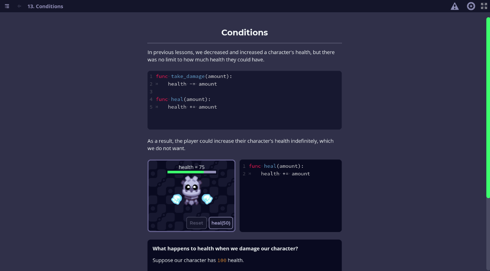


> ※ 本チュートリアルは、変数・if文・関数が何かをなんとなく知っていれば進められるように書いています。不安な方は、上の教材を1〜2時間やってから第2章へ進むのがおすすめです。

---

## 1-2. 4つの基本概念

Godotのゲームは **「ノード」を木のようにつないだもの** です。まずこの4つの言葉を覚えてください。

### ノード（Node）
ゲームを作る**最小の部品**です。種類が何十種類もあります。

- 画像を表示するもの（Sprite2D）
- 文字を表示するもの（Label）
- 音を鳴らすもの（AudioStreamPlayer）
- カメラ（Camera2D / Camera3D）
- 当たり判定を持つもの（CollisionShape2D）…など

すべてのノードに共通するのは、名前を持つこと、プロパティ（設定値）を編集できること、別のノードを子として持てることです。

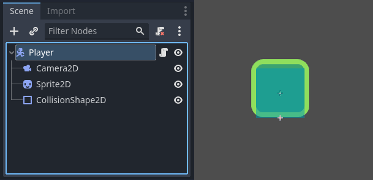

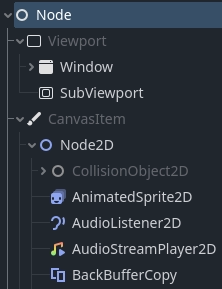


> **名前の見分け方**: 2D用のノードは名前の最後が「2D」、3D用は「3D」です（例: Sprite2D と MeshInstance3D）。Godot 4以降、3Dの基本ノードは Node3D と呼びます（昔の「Spatial」は廃止）。

### シーン（Scene）
ノードを木の形にまとめて**保存したもの**です（拡張子 `.tscn`）。

例: プレイヤーのシーン

```
Player (CharacterBody2D)   ← 一番上（ルートノード）
├─ Sprite2D            ← 見た目
├─ CollisionShape2D    ← 当たり判定
└─ Camera2D            ← 追いかけるカメラ
```

シーンには何でもなれます。キャラクター、武器、メニュー、1軒の家、ステージ全体。
**シーンは別のシーンの中に置く（入れ子にする）ことができます。** 置いたシーンは、エディタ上では1個のノードのように見えます。

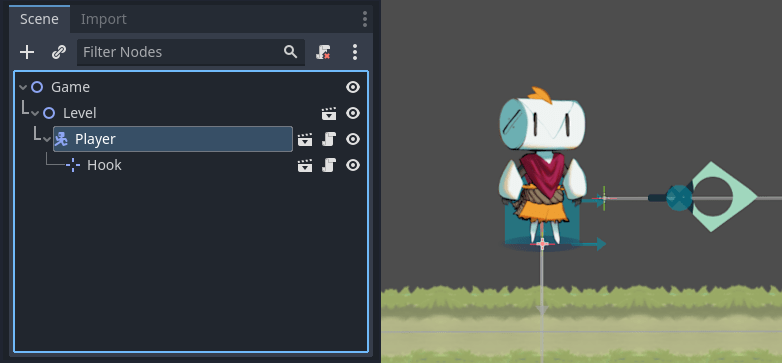

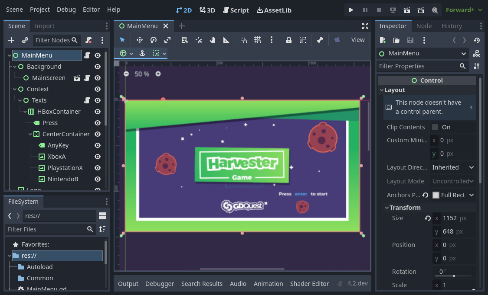


### シーンツリー（Scene tree）
ゲームの全シーンが集まった、1本の大きな木です。シーンはノードの木なので、シーンツリーもノードの木です。「ゲーム = シーンの木」と考えると整理しやすくなります。

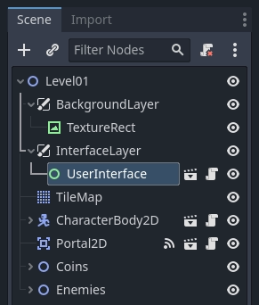


### シグナル（Signal）
ノードが「何か起きた」と知らせるための**合図（メッセージ）**です。

- ボタンが押されたら `pressed` というシグナルが出る
- キャラクターが敵に触れたら `body_entered` というシグナルが出る

別のノードが「そのシグナルが出たらこの関数を実行して」と登録（接続）しておくと、反応させられます。ノード同士を直接つなぎこまなくて済むので、作りが柔らかくなります。

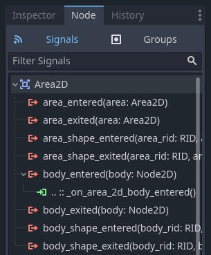


### まとめ
| 用語 | 一言で |
|---|---|
| ノード | 部品 |
| シーン | 部品を組み合わせて保存したもの |
| シーンツリー | ゲーム全体の木 |
| シグナル | 「起きたよ」という合図 |

---

## 1-3. エディタを見てみよう

### プロジェクトマネージャー
Godotを起動して最初に出る画面です。

- **Projects タブ**: 既存のプロジェクトを開く、新規作成する、取り込む（Import）
- **Asset Store タブ**（旧称 Asset Library）: 無料のデモやアドオンを探す。ネットに接続して使う
- **Settings メニュー**: エディタの言語、テーマ、表示倍率などを変えられる

    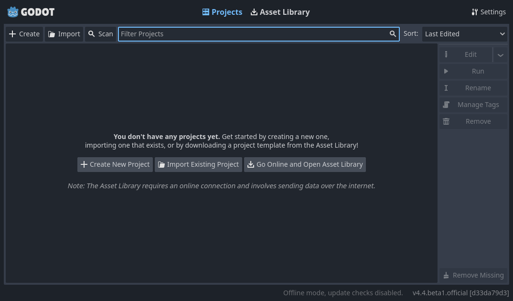

    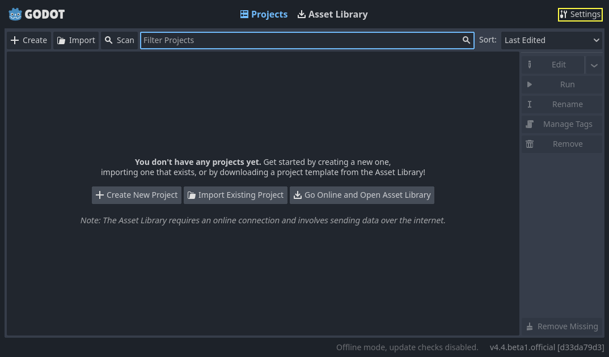


> ※ エディタ内の表示を日本語にしたい場合は、Settings で Language を変更できます。ただしこのチュートリアルは、公式ドキュメントと照合しやすいよう**英語表記**で書いています。

### エディタの主な領域
プロジェクトを開くと、次のような画面になります。

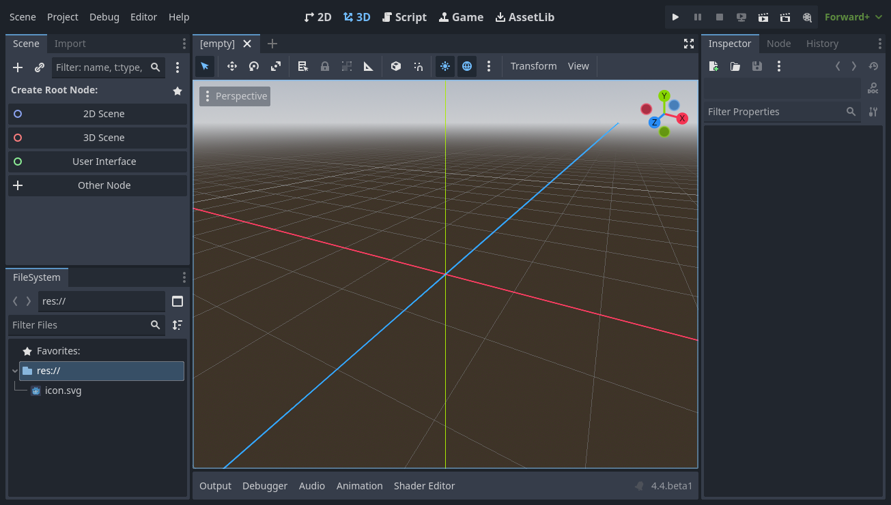

> ※ 公式ドキュメントの画像です（4.4世代の画面で、右上のタブ名が Inspector / Node / History になっています。4.6以降は Inspector / Signals / Groups です）。


| 領域 | 役割 |
|---|---|
| メインメニュー（左上） | Scene、Project、Debug、Editor、Help など |
| ワークスペースボタン（上中央） | 画面の切り替え（下の5つ） |
| 実行ボタン（右上） | プロジェクト実行、現在のシーン実行、停止など |
| Scene ドック | いま開いているシーンのノード一覧。ノードの追加・削除・並べ替え |
| FileSystem ドック | プロジェクト内のファイル一覧。画像・音・スクリプト・シーン |
| Inspector | 選んだノードのプロパティを編集 |
| Signals / Groups タブ | Inspectorの横のタブ。シグナルの接続、グループの設定。パネルが狭いと Groups は右端に隠れる（▶ で送る） |
| 下部パネル | デバッグ出力、アニメーションエディタなど。クリックで縦に開く |

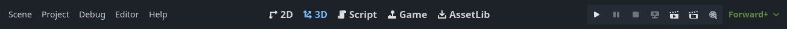

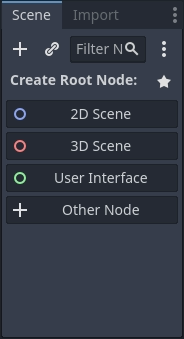

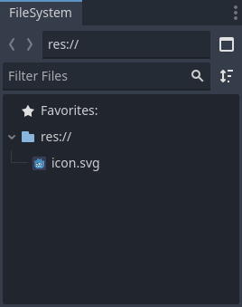

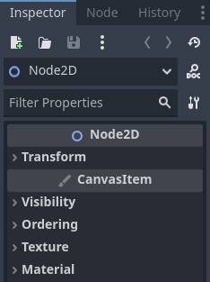

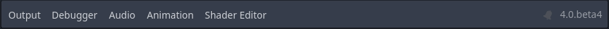


> ⚠ ドックの位置は人によって違うことがあります。ドックは移動・リサイズできます。見つからないときは、名前（Scene / FileSystem / Inspector）を手がかりに探してください。

### 5つのメイン画面
画面上部中央にある5つのボタンで切り替えます。

| 画面 | 用途 |
|---|---|
| **2D** | 2Dゲームを作る。UI（メニューや文字）を作るのもここ |
| **3D** | メッシュ、ライト、3Dのステージを作る |
| **Script** | コードエディタ。デバッガーやコード補完、組み込みのリファレンス付き |
| **Game** | 実行中のゲームがここに表示される。実行中に一時停止したり調整できるが、**変更は保存されない** |
| **Asset Store** | 無料のアドオンや素材を探す（旧称 AssetLib） |

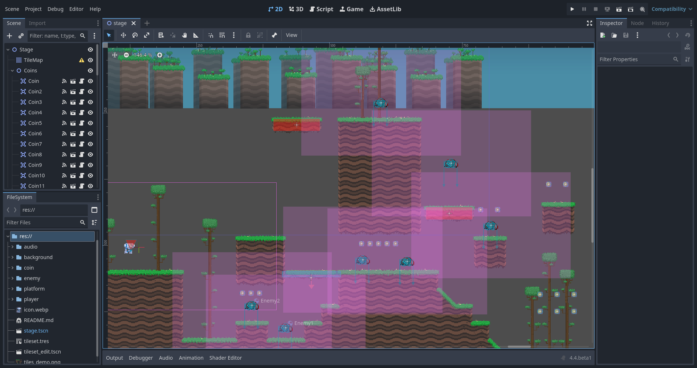

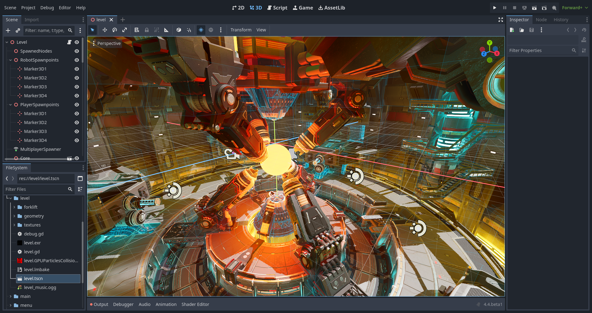

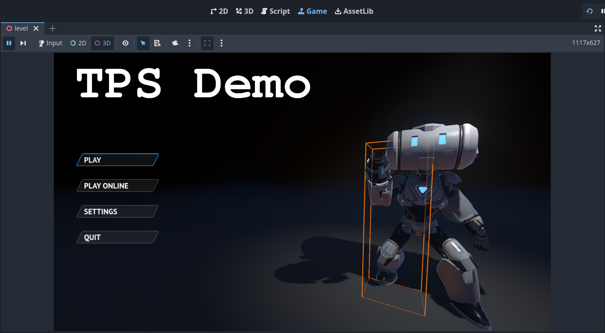

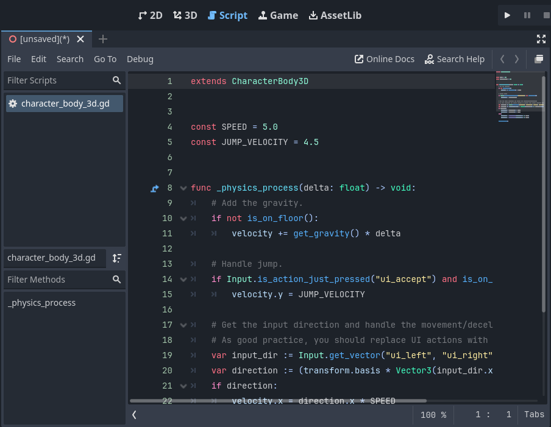

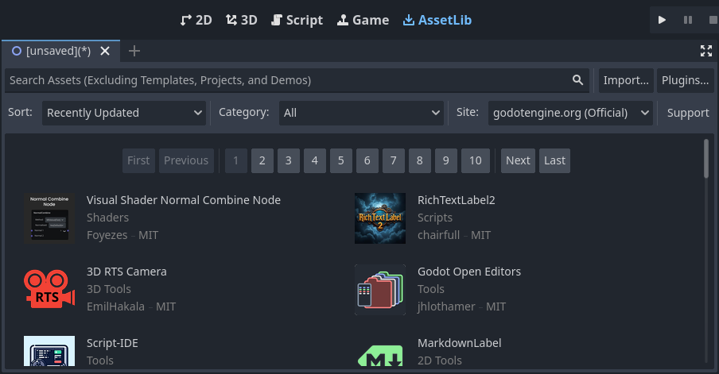


> ⚠ ノードを追加したのに画面が3Dのまま、または何も見えないときは、上部の「2D」ボタンを押してみてください。2Dのゲームなのに3D画面が開いているのは、初心者がよく出会う状態です。

### 組み込みリファレンス（わからない言葉が出たら）
エディタにはクラスやメソッドの説明が内蔵されています。

- どこでも **F1** キー（macOSは Opt + Space）で検索窓が開く
- コードエディタで、関数名や変数名を **Ctrl + クリック**（macOSは Cmd + クリック）するとその説明に飛ぶ
- Scene ドックでノードを右クリック > Open Documentation

    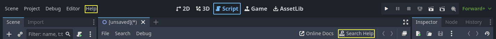

    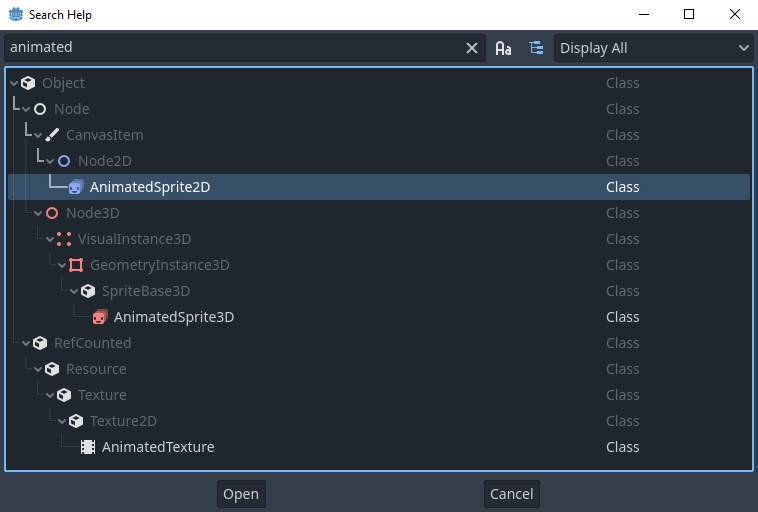

    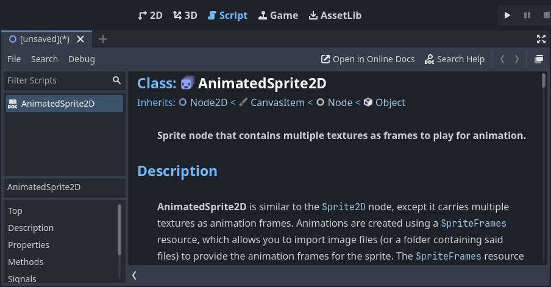


---

## 1-4. 学び方・困ったときは

- **マニュアル**（https://docs.godotengine.org/）は、機能の説明を探すものです。「RPGの作り方」のようなジャンル別の解説は載っていません。
- **クラスリファレンス**は、各クラスの関数・プロパティ・シグナルの辞書です。
- 質問するなら、公式の Godot Forum（https://forum.godotengine.org/）が向いています。質問時に次の情報を書くと、早く答えが得られます。
  1. 何を作りたいか（やりたいこと）
  2. エラーが出ているなら、**エラーメッセージをそのまま**（Debugger パネルのコピーアイコンでコピーできる）
  3. コードは**テキストで**貼る（写真は不可）
  4. Scene ドックのスクリーンショット（コードはシーンの構成と一体のため）
  5. 使っている Godot のバージョン（今回は 4.7）

---

## 1-5. Godotの設計の考え方

「なぜこういう作りなのか」がわかると、あとの理解が早くなります。

1. **シーンの組み合わせ（コンポジション）**: 点滅するランプのシーンを作り、それを使った壊れたランタンのシーンを作り、それを並べた街を作る。ランプの色を直して保存すれば、街中のランタンが一斉に更新される。
2. **シーンは継承もできる**: 「キャラクター」シーンを元にした「魔法使い」シーンを作れる。
3. **全部入り**: スクリプト、アニメーション、タイルマップなどのエディタを標準搭載。
4. **オープンソース**: 誰でも中身を読めて、改造できる。
5. **エディタ自体がGodotのゲーム**: エディタはGodotのUI機能で動いている。だからエディタを拡張するプラグインも、ゲームと同じコードで書ける。
6. **2Dと3Dが別のエンジン**: 2Dの単位は**ピクセル**。2Dエンジンと3Dエンジンは別物だが、組み合わせることもできる。

---

## 1-6. やってみよう（練習）

実際にGodotを起動して、次の確認をしてください。ここができれば、第2章へ進めます。

1. Godot 4.7 を起動し、プロジェクトマネージャーが開く
2. 新規プロジェクトを作る（「Create」をクリック。Project Name に `hello`、Project Path は任意のフォルダ。他の設定は初期値のままでOK）
3. エディタが開いたら、次の場所を見つけてください:
   - [ ] 2D / 3D / Script / Game / Asset Store のボタン
   - [ ] Scene ドック（左上）
   - [ ] FileSystem ドック（左下）。中に `icon.svg` があるはず
   - [ ] Inspector（右）
   - [ ] 実行ボタン（右上）
4. F1 キーを押して、ヘルプ検索窓で「Sprite2D」と入力 → ダブルクリックで説明が開く
5. 上部の「2D」と「3D」を切り替えて、画面の違いを見る

✅ すべて見つかれば完了。次は第2章へ。
