# 第2章 Step by step（ノード・シーン・スクリプト・シグナル）

この章では、Godotの基本操作を6つのレッスンで身につけます。

1. ノードとシーン（Hello World を表示）
2. インスタンス化（ボールを増やして弾ませる）
3. スクリプト言語の選び方
4. はじめてのスクリプト（アイコンを回して動かす）
5. プレイヤーの入力（キーで操作する）
6. シグナル（ボタンで止める・点滅させる）

---

## レッスン1: ノードとシーン

### 1-1. 新しいプロジェクトを作る
1. プロジェクトマネージャーで「Create」をクリック
2. Project Name に `step_by_step`、Project Path は好きな場所
3. 他は初期値のまま「Create」

✅ 空のエディタが開く。FileSystem ドックに `icon.svg` がある（このアイコンは後のレッスンで使う）。

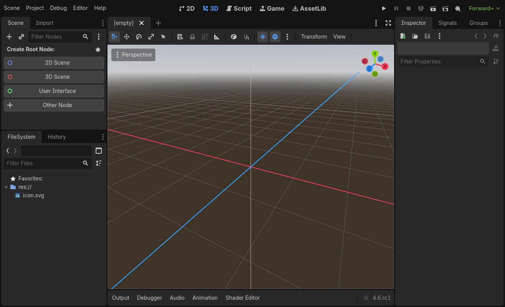


### 1-2. 最初のノードを置く
空のシーンでは、Scene ドックに4つのボタンが出ています。

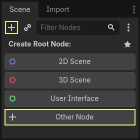


| ボタン | 作られる根ノード |
|---|---|
| 2D Scene | Node2D |
| 3D Scene | Node3D |
| User Interface | Control |
| Other Node | 好きな種類を選ぶ |

これは便利ボタンです。今回は **Other Node** を使います（Scene ドック左上の「Add Child Node」ボタン、または Ctrl+A でも同じです）。

1. 「Other Node」をクリック
2. 「Create New Node」ダイアログが開く。上の検索欄に `Label` と入力

    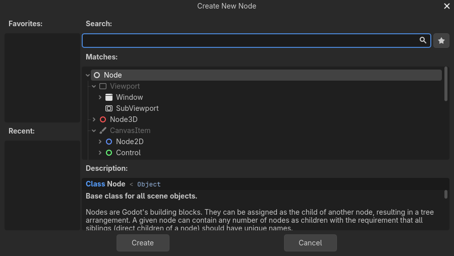

3. 一覧から **Label** を選び、下の「Create」ボタンを押す

    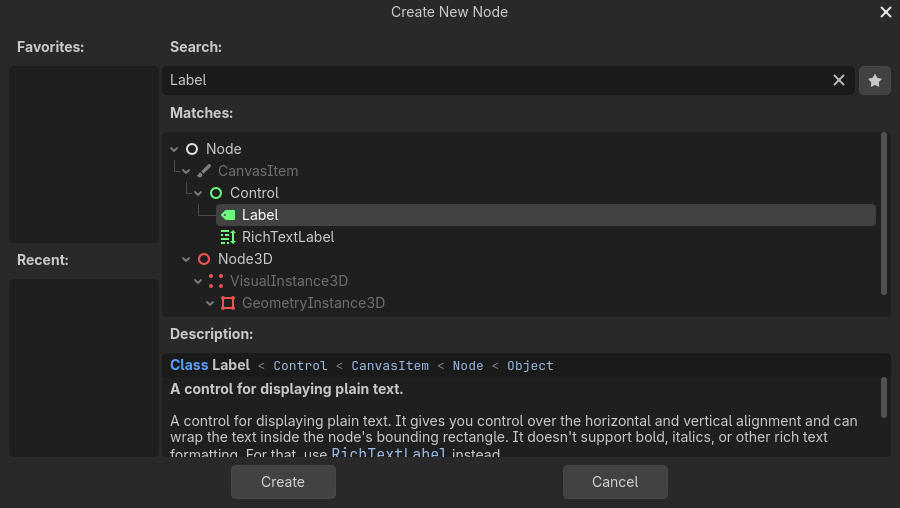


✅ ビューポートの左上に小さな「Label」の文字が出る。Scene ドックにノードが1つ入り、右の Inspector にプロパティが出る。
画面は自動で 2D 画面に切り替わる（LabelはUI用の2D系ノードのため）。

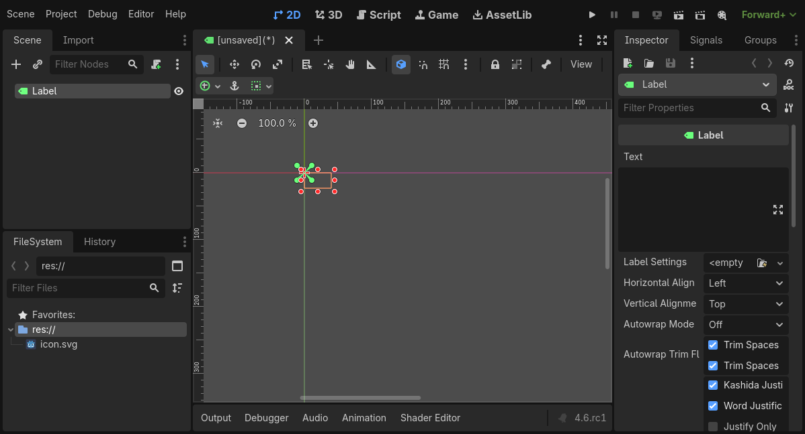


### 1-3. プロパティを変える
1. Scene ドックで Label を選択（選択済みならそのまま）
2. 右の **Inspector** で **Text** 欄を探し、クリックして `Hello World` と入力

    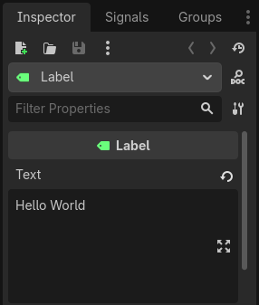


✅ 入力しながら、ビューポートの文字が変わる。

> ⚠ Text 欄が見えないときは、Inspector 上部の検索欄に `text` と入力すると絞り込めます。Inspector のプロパティは、検索で探すのが早いです。

### 1-4. 位置を動かす
1. ビューポート上部のツールバーで **Move（矢印の十字）ツール**を選ぶ（※ 選択ツールのままでも、ノードをドラッグで動かせることが多い）

    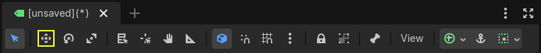

2. Label をドラッグして、画面の中央（白い四角の枠の中）へ動かす

    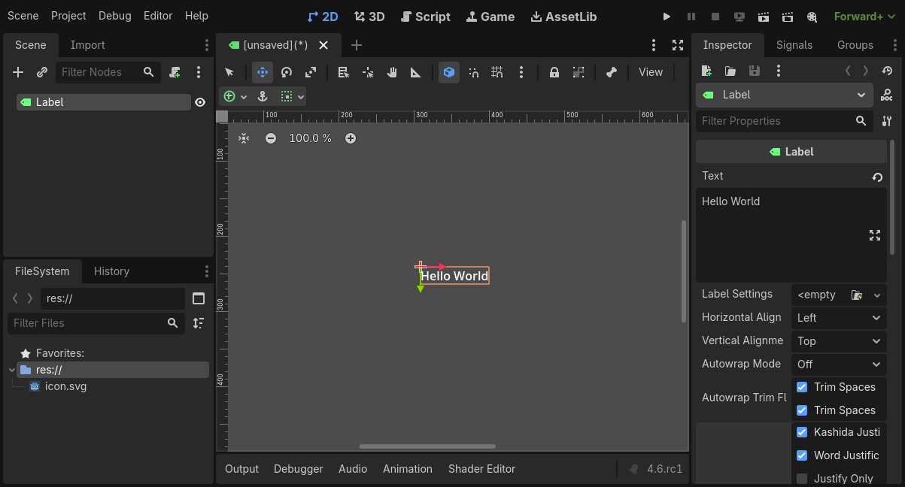


### 1-5. シーンを実行する
1. 右上の **Run Current Scene**（▶に「シーンの枠」のアイコン）をクリック。または **F6**（macOS: Cmd+R）

    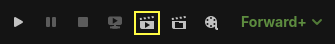

2. 「シーンを保存してください」というダイアログが出るので、ファイル名を `label.tscn` にして「Save」

    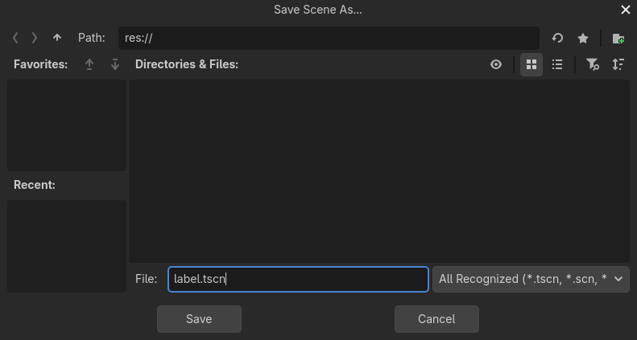


> **res:// とは**: 保存ダイアログの一番上に出る `res://` は、プロジェクトのフォルダ（resource path = リソースの場所）のことです。エディタは、プロジェクトの外には保存できません。

✅ 新しいウィンドウが開き、「Hello World」が表示される。
ウィンドウを閉じるか、エディタの右上の **Stop**（■）ボタンで停止する。ショートカットの F8（macOS: Cmd+.）は、エディタ側を一度クリックしてから押す（実行中のゲームのウィンドウが前にあると、効かないことがある）。

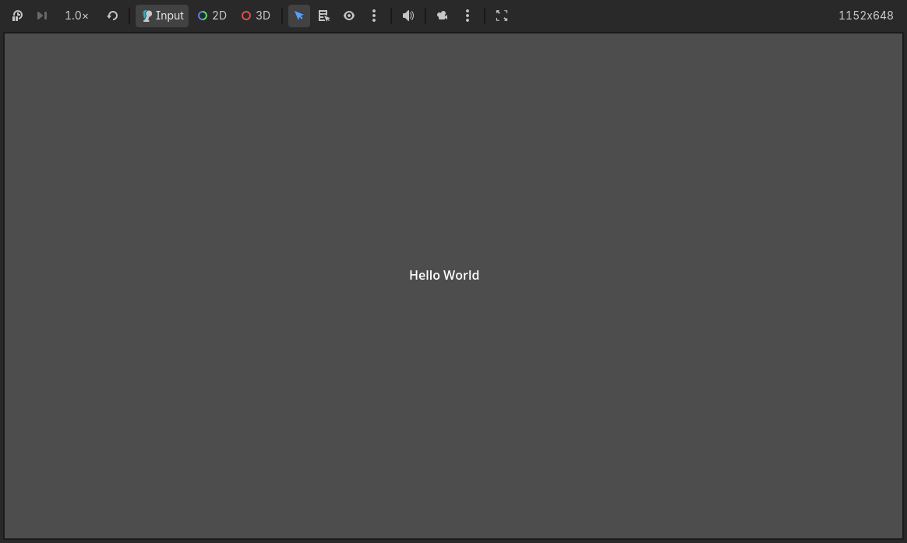


### 1-6. メインシーンを決める
- **Run Current Scene (F6)**: いま開いているシーンを実行
- **Run Project (F5)**: プロジェクトの**メインシーン**を実行

1. **F5**（macOS: Cmd+B）を押す

    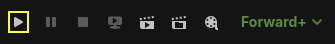

2. 「No main scene has ever been defined. Select one?」というダイアログが出る → いちばん簡単なのは **Select Current**（いま開いているシーンを選ぶ）。「Select」を押して `label.tscn` をダブルクリックしても同じ

    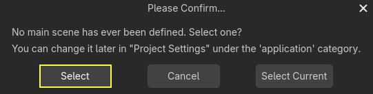


✅ もう一度「Hello World」が出る。以後、F5 を押すと、いつもこのシーンから始まる。

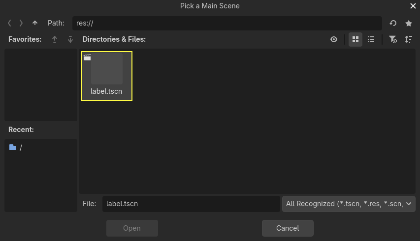


> ⚠ 「F5と F6 の違い」は初心者がよくハマる点です。思った画面が出ないときは、どちらを押したか確認してください。

> ※ メインシーンの設定は、プロジェクトフォルダの `project.godot` に書かれます。メニュー Project > Project Settings からも変更できます。

---

## レッスン2: インスタンス化

保存したシーンは**設計図**になります。同じ設計図から、何個でも「コピー（インスタンス）」を作れます。これを**インスタンス化**と呼びます。

- インスタンスはどれも、元のシーンと同じ構造・同じ設定値で始まる
- でも、1個ずつ別々に設定を変えられる
- 元のシーンを直して保存すると、**全インスタンスに反映**される（個別に上書きした項目は除く）

    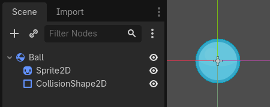

    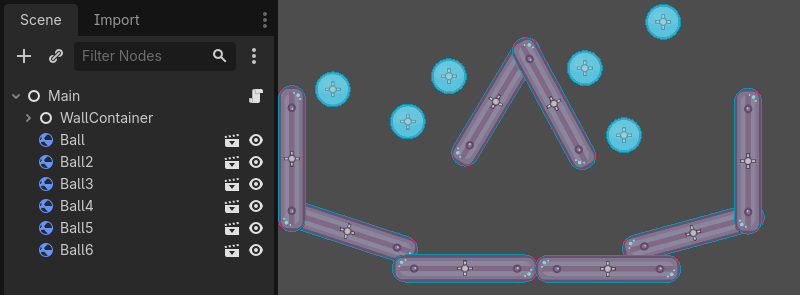


### 2-1. サンプルプロジェクトを開く
1. instancing_starter.zip をダウンロードして、展開する（URLは「はじめに」にあります）
2. Godot を起動し、プロジェクトマネージャーで **Import** をクリック

    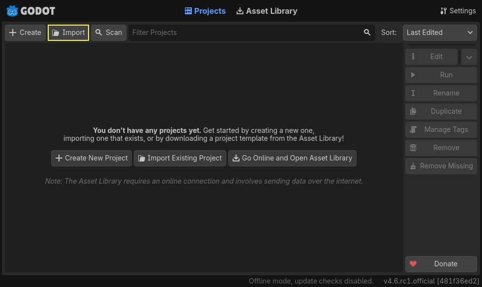

   - すでにエディタを開いている場合: メニュー Project > Quit to Project List（Ctrl+Shift+Q）
3. ダイアログで、展開したフォルダの `project.godot` をダブルクリック

    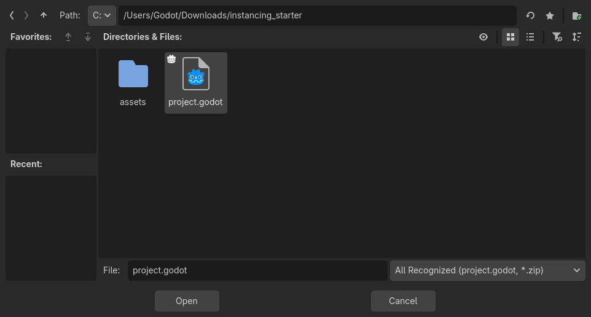

4. 画面下の **Import** ボタンをクリック（4.2 では「Import & Edit」だった）

    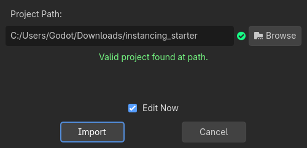

5. 「古いバージョンのGodotで最後に開かれた」という警告が出たら **OK**

✅ エディタが開く（4.7.2 では、最初は3D画面が開く）。FileSystem に `Main.tscn`（壁だけのシーン）と `Ball.tscn`（ボール）がある。

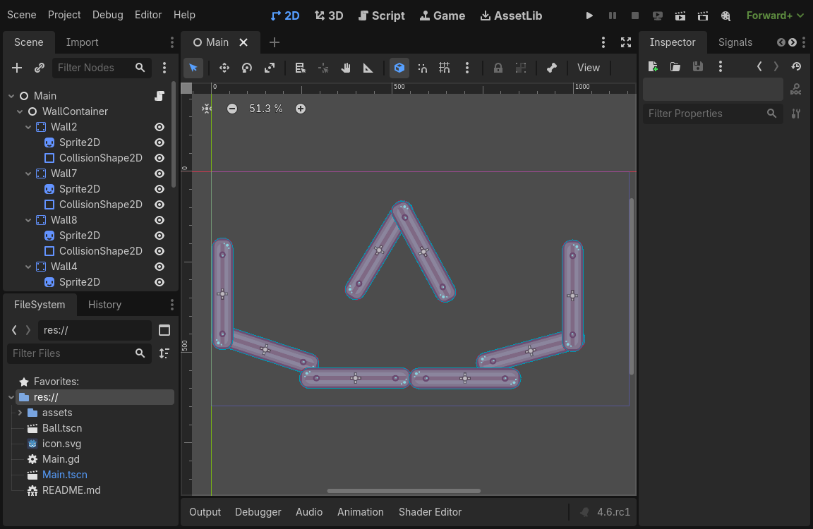


> ⚠ 空の3D画面が出たら、上部の「2D」ボタンを押す。`Main.tscn` が開いていなければ、FileSystem で `Main.tscn` をダブルクリック。

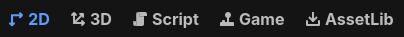


> ※ 変換後のプロジェクトは、古いバージョンでは開けなくなることがあります。気になる場合は、展開したフォルダを先にコピーしてください。

### 2-2. ボールを置く
1. Scene ドックで根ノード **Main** をクリックして選択
2. Scene ドック上部の **Instantiate Child Scene**（鎖のリンクのアイコン）をクリック

    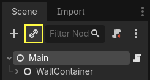

   - ツールチップは「Instantiate a scene file as a Node」
3. 一覧から **Ball.tscn** をダブルクリック

    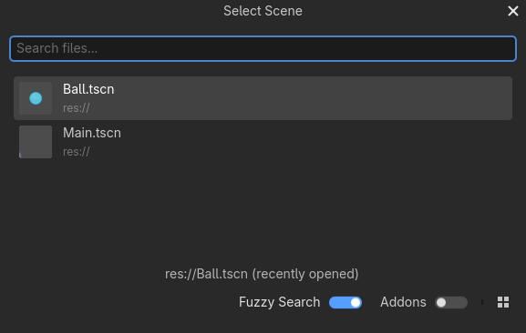


✅ ボールが画面の左上に出る。Scene ドックの Main の下に「Ball」が追加され、横にクラッパーボード風のアイコンが付く（「別シーンのインスタンス」の印。クリックすると Ball.tscn が開く）。

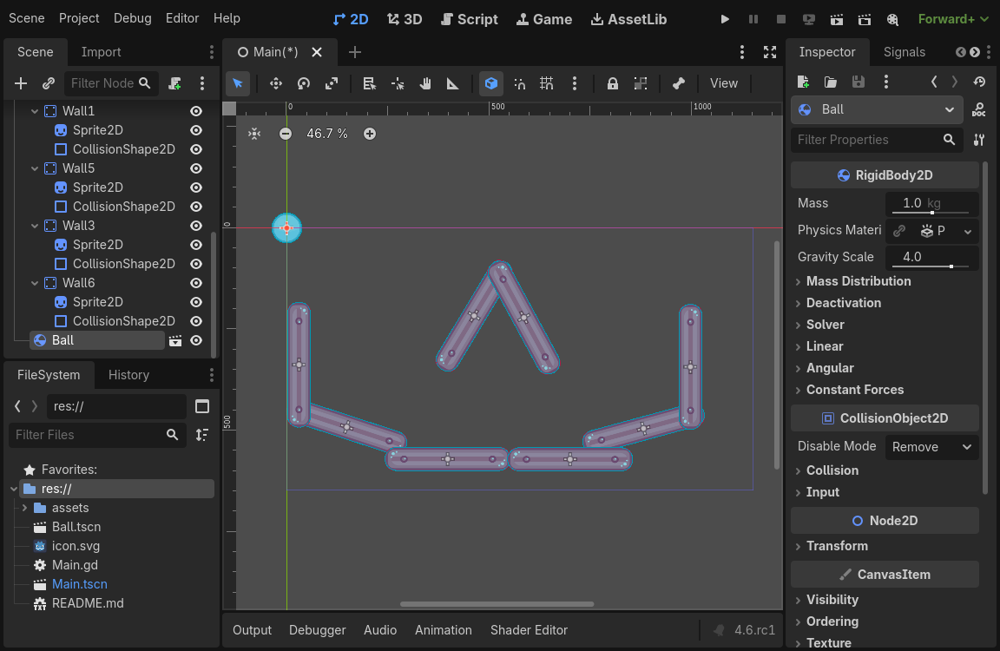


4. ボールをドラッグして、画面の中央へ動かす

    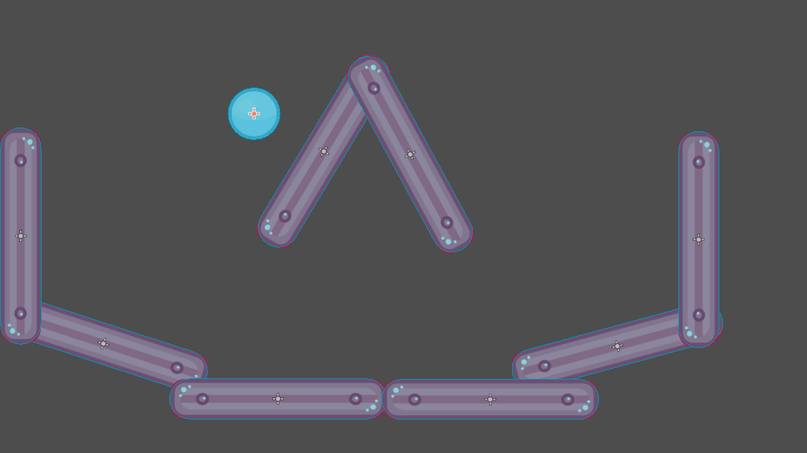

5. **F5**（macOS: Cmd+B）で実行 → ボールが落ちる
6. ウィンドウを閉じて戻る

### 2-3. ボールを増やす
1. ボールを選んだまま **Ctrl+D**（macOS: Cmd+D）で複製
2. 複製したボールを別の場所へドラッグ
3. 数回繰り返して、数個にする

    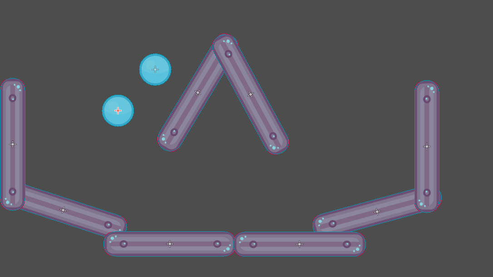

4. 実行 → 全部が別々に落ちる

    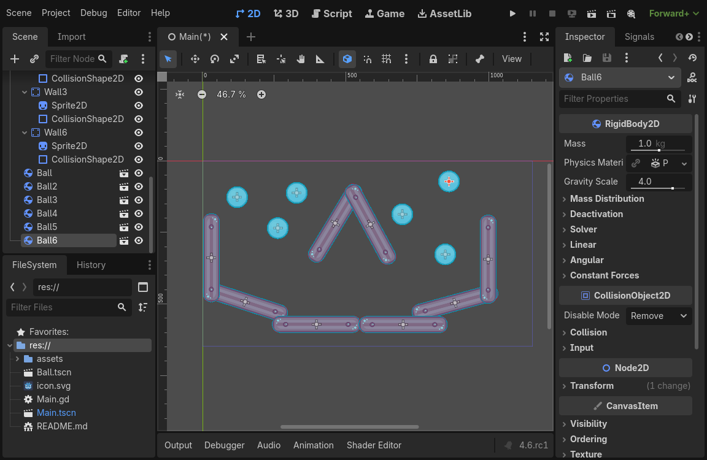


> 複製されたボールは、Scene ドック上で名前が自動的にばらばらになります（Ball、Ball2…）。

### 2-4. 元のシーンを直して、全部に反映する
1. FileSystem ドックで **Ball.tscn** をダブルクリックして開く

    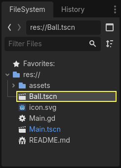

2. Scene ドックで根ノード **Ball**（RigidBody2D）をクリック
3. Inspector で **Physics Material**（旧称 Physics Material Override）の項目を探す
   - 見つからなければ Inspector 上部の検索欄に `physics` と入力
4. その項目をクリックして展開する

    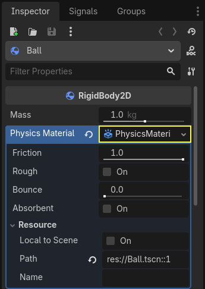

5. **Bounce** の数値欄をクリックして `0.5` と入力し Enter

    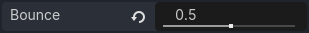

6. Main タブに戻り、実行（F5） → 全部のボールがよく弾む

> ⚠ **ここが4.2と違って迷いやすいところです。**
> 公式の4.7ドキュメントは「PhysicsMaterialをクリックして展開」としか書いていません。
> - 項目に `PhysicsMaterial` と入っている → クリックで展開（▶）
> - 項目が `<empty>` → クリック > **New PhysicsMaterial** を選ぶ → できた項目をクリックして展開（※）
>
> どちらでも、展開すると Friction / Rough / Bounce / Absorbent が出ます。

### 2-5. 1個だけ変える
1. Main のタブへ戻る

    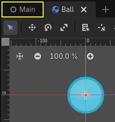

2. ボールを1個選ぶ
3. Inspector で **Gravity Scale** を探して `10` にする（見つからなければ検索欄に `gravity`）

    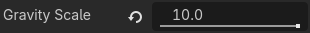

4. 値の右に、灰色の「戻す」ボタン（丸い矢印）が出る

    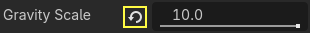

5. 実行 → そのボールだけ、ものすごく速く落ちる

> **戻すボタンの意味**: 「元シーン（Ball.tscn）の値を、このインスタンスだけ上書きしている」という印です。上書きした値は、元のシーンを直しても変わりません。戻すボタンを押すと、元の値に戻ります。

> ⚠ PhysicsMaterial の値を、Main の中のボールから直接変えようとしても編集できません。PhysicsMaterial は**リソース**という種類で、共有されているためです。インスタンス専用にしたいときは、その項目を右クリック > **Make Unique** を選びます。リソースの詳細は後の章で出てきます。

### 2-6. 「シーンで考える」設計
シューティングゲームなら、プレイヤー、敵、弾、HUD…のように、**画面に見えるものごとにシーンを作る**と、作りが自然になります。
家のシーンの中に部屋のシーンを置き、街のシーンの中に家のシーンを置く、というように入れ子にして世界を組み立てます。
プログラミングで難しい設計パターンを考えるより、先に「画面に見えるもの」を分けるのがGodot流です。

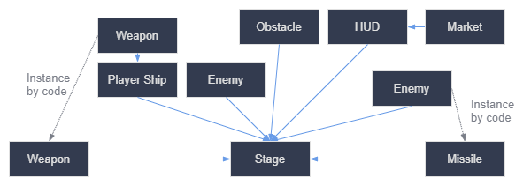

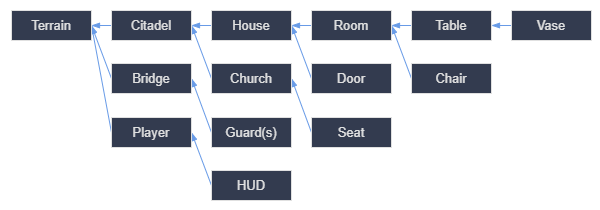


### まとめ
- シーンは設計図。何個でも置ける（インスタンス）
- 元を直すと全体に反映。個別の上書きもできる

---

## レッスン3: スクリプト言語

**スクリプトは、ノードにくっつけて、そのノードの動きを増やすもの**です。スクリプトは、くっつけた先のノードの機能（プロパティと関数）をすべて引き継ぎます。

| 言語 | 特徴 |
|---|---|
| **GDScript** | Godot専用。構文が軽く、エディタとの連携が最も強い。コンパイルが速い。初心者はこれ |
| C# | .NET版のエディタが必要。外部エディタ（VS Code等）も要る。経験者向け |
| C++（GDExtension） | 最高速度。エンジンを再コンパイルせずに書ける。上級者向け |

- 1つのプロジェクトで複数の言語を混ぜられます。
- GDScriptはPythonに似て、インデント（字下げ）でブロックを表します。
- **このチュートリアルはすべてGDScriptです。**

---

## レッスン4: はじめてのスクリプト

目標: Godotのアイコンをくるくる回して動かす。

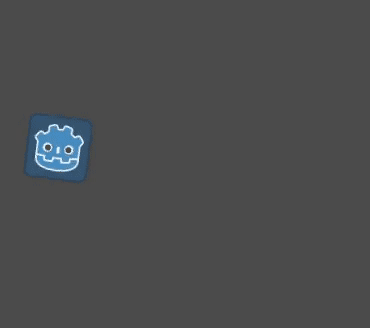


### 4-1. 準備
1. 新しいプロジェクトを作る（名前は `first_script`）。FileSystem に `icon.svg` がある
2. Scene ドックの **Other Node** をクリック

    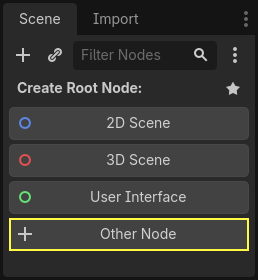

3. 検索欄に `Sprite2D` と入力し、ダブルクリックで作成

    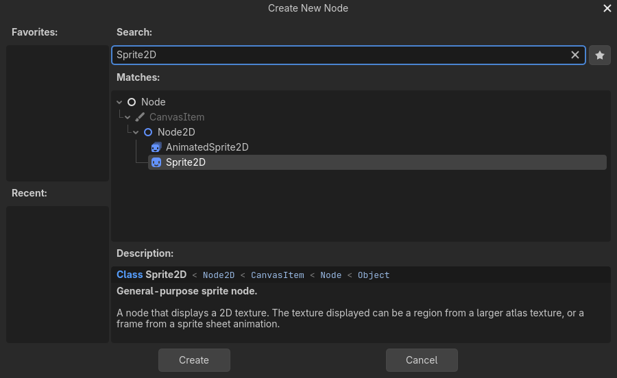

    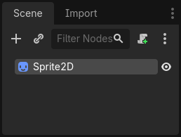

4. Inspector の **Texture** が `<empty>` になっている。FileSystem の `icon.svg` を、そこへドラッグ＆ドロップ

    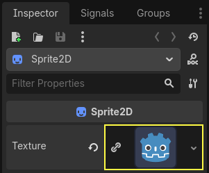


✅ ビューポートに、Godotのアイコンが出る。

5. アイコンをドラッグして、画面の中央へ動かす

    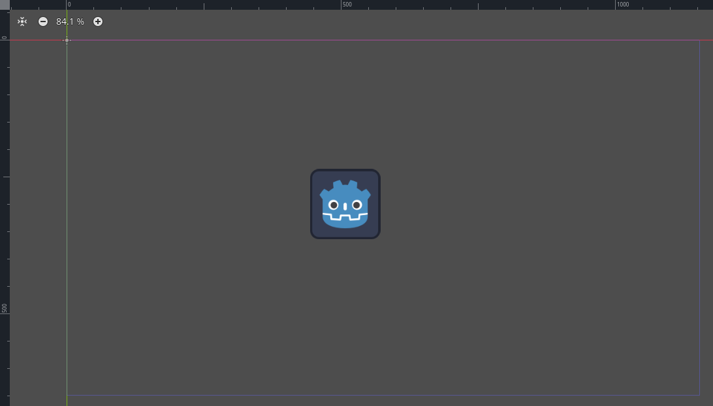


> ※ 画像をビューポートにドロップすると、Sprite2Dが自動で作られるショートカットもあります。

### 4-2. スクリプトを作ってつける
1. Scene ドックで Sprite2D を**右クリック > Attach Script**

    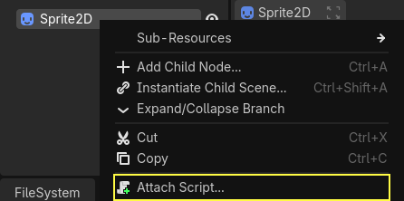

2. 「Attach Node Script」ウィンドウが開く。**Template** を `Node: Default` から **`Object: Empty`** に変える（空のファイルから始めるため）
3. 他は初期値のまま「Create」をクリック

    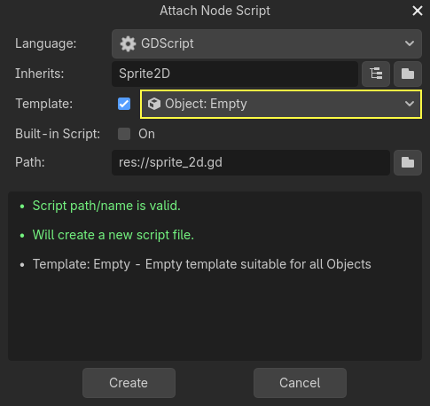


✅ 画面が **Script** 画面に切り替わり、`sprite_2d.gd` が開く。中身は1行:

```gdscript
extends Sprite2D
```

> **`extends` の意味**: 「このスクリプトは Sprite2D の機能を引き継ぐ」という宣言です。Sprite2D が持つ `texture`、`position`、`rotation` などのプロパティが、そのまま使えるようになります。
> Inspector では「Title Case」（Rotation）で表示されますが、コードでは「snake_case」（rotation、複数語は angular_speed）で書きます。プロパティ名にマウスを重ねると、コードでの名前が出ます。

### 4-3. Hello, world!
`extends Sprite2D` の下に、次を追加します。

```gdscript
func _init():
    print("Hello, world!")
```

- `func` は関数を定義する言葉
- `_init` は特別な名前で、ノードが作られた瞬間に自動で呼ばれる
- **2行目の字下げ（インデント）が必要**。ないと「Indented block expected」のエラーになる
- コードエディタは、`:` で改行すると自動で字下げし、`(` や `"` は閉じ側も自動で入れる。**字下げを手で足さない**こと。閉じカッコは、そのまま打てば上書きされる
- 入力中に出る補完の候補（ポップアップ）が出たまま Enter を押すと、改行ではなく**候補が確定される**。意図と違うときは Esc で候補を閉じてから Enter を押す

実行します。
1. シーンを `sprite_2d.tscn` として保存（Ctrl+S）
2. **F6**（macOS: Cmd+R）

✅ 下部の **Output** パネルが開き、`Hello, world!` と表示される。

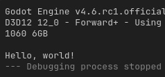


確認できたら、`_init` 関数は**削除**して、`extends Sprite2D` だけの状態に戻します。

### 4-4. 回転させる
`extends Sprite2D` の下に、変数を2つ追加します。

```gdscript
var speed = 400
var angular_speed = PI
```

- `speed` は速さ（ピクセル／秒）、`angular_speed` は回転の速さ（ラジアン／秒。PI は半回転）
- Godotの角度は標準でラジアンです

ファイルの末尾に、次の関数を追加します。

```gdscript
func _process(delta):
    rotation += angular_speed * delta
```

- `_process(delta)` は**毎フレーム自動で呼ばれる**関数
- `delta` は「前のフレームから経過した時間（秒）」。これを掛けることで、パソコンの性能が違っても同じ速さで動く
- `rotation` は Sprite2D（が引き継いだ Node2D）の回転

実行（F6） ✅ アイコンがその場でくるくる回る。

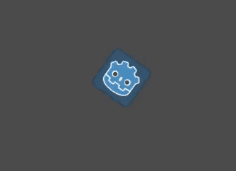


### 4-5. 前に進ませる
`_process` の中（`rotation` の行と同じ字下げ）に、2行追加します。

```gdscript
    var velocity = Vector2.UP.rotated(rotation) * speed
    position += velocity * delta
```

- `Vector2.UP` は「上を向いた矢印（ベクトル）」
- `.rotated(rotation)` で、アイコンの向きに合わせて回転させる
- `* speed` で、速さを掛ける → これが「進行方向と速さ」
- `position += velocity * delta` で、その分だけ位置を動かす

実行 ✅ アイコンが円を描いて走り回る。画面からはみ出していくこともある。

### 完成コード（sprite_2d.gd）

```gdscript
extends Sprite2D

var speed = 400
var angular_speed = PI

func _process(delta):
    rotation += angular_speed * delta
    var velocity = Vector2.UP.rotated(rotation) * speed
    position += velocity * delta
```

> この動かし方は、壁や床との衝突を考えません。衝突を考える動かし方は、第3章の2Dゲームで出てきます。

---

## レッスン5: プレイヤーの入力

目標: 矢印キーで回転と前進をさせる。前のレッスンの `sprite_2d.gd` を変更します。

入力を扱う方法は主に2つあります。
1. `_unhandled_input()` — キーが押された「瞬間」に反応する（ジャンプなど）
2. `Input` — **毎フレーム**、いま押されているかを調べる ← 今回はこっち

### 5-1. 左右キーで回転
`_process` の中の `rotation += angular_speed * delta` の行を、次の5行に**置き換え**ます。

```gdscript
    var direction = 0
    if Input.is_action_pressed("ui_left"):
        direction = -1
    if Input.is_action_pressed("ui_right"):
        direction = 1
    rotation += angular_speed * direction * delta
```

- `direction` は回る向き。0=回らない、1=右、-1=左
- `Input.is_action_pressed("ui_left")` は、そのアクションが押されていれば `true`
- `ui_left`、`ui_right`、`ui_up` はどのプロジェクトにも最初から入っている「アクション」（キーボードの矢印キー、ゲームパッドの十字キー）
- アクションの一覧は、Project > Project Settings > **Input Map** タブで見られる

前進の2行は、いったん**コメントアウト**します（行頭に `#` を付ける）。

```gdscript
    #var velocity = Vector2.UP.rotated(rotation) * speed
    #position += velocity * delta
```

実行 ✅ 左右キーで回る。

### 5-2. 上キーで前進
コメントアウトを外し（`#` を消す）、`var velocity` の行を次の3行に**置き換え**ます。

```gdscript
    var velocity = Vector2.ZERO
    if Input.is_action_pressed("ui_up"):
        velocity = Vector2.UP.rotated(rotation) * speed
```

`Vector2.ZERO` は「長さ0のベクトル」、つまり止まっている状態です。

実行 ✅ 左右で回り、上キーで前進する。

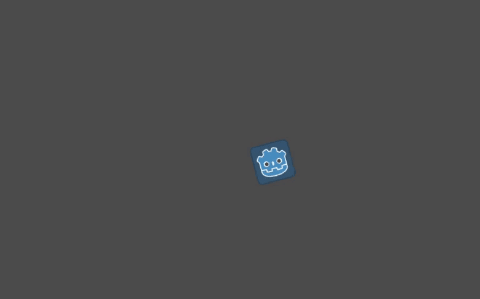


### 完成コード

```gdscript
extends Sprite2D

var speed = 400
var angular_speed = PI

func _process(delta):
    var direction = 0
    if Input.is_action_pressed("ui_left"):
        direction = -1
    if Input.is_action_pressed("ui_right"):
        direction = 1
    rotation += angular_speed * direction * delta

    var velocity = Vector2.ZERO
    if Input.is_action_pressed("ui_up"):
        velocity = Vector2.UP.rotated(rotation) * speed

    position += velocity * delta
```

---

## レッスン6: シグナル

目標: ボタンで動きを止めたり再開したりする。さらに、タイマーでアイコンを点滅させる。

### 6-1. シーンを組み立てる
1. メニュー Scene > **New Scene**

    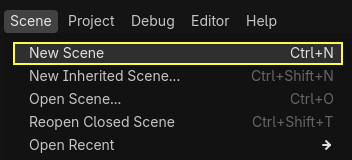

2. Scene ドックの **2D Scene** ボタン（根ノードが Node2D になる）

    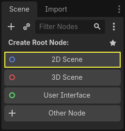

3. FileSystem の `sprite_2d.tscn` を、Scene ドックの Node2D の上にドラッグ＆ドロップ → インスタンス化される

    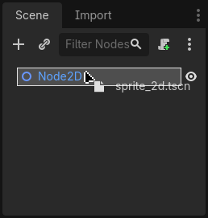

4. Node2D を**右クリック > Add Child Node** → `Button` を検索して作成

    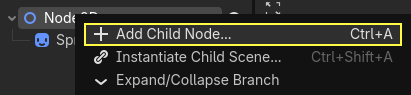

    

   - Sprite2D と同じ階層（兄弟）に Button が入る
5. ボタンを、ビューポートで、ハンドルをドラッグして大きくし、アイコンの近くへ動かす

    

    

   - ハンドルが出ないときは、ツールバーで選択ツールを選ぶ
6. Button の Inspector で **Text** を `Toggle motion` にする

    

7. `node_2d.tscn` として保存して、F6で実行

    


✅ ボタンは出るが、押しても何も起きない。

> ここで、入力のレッスンの `sprite_2d.gd` は、**レッスン4の完成コード（自動で進む版）** に戻しておきます（次の6-2で説明）。

### 6-2. エディタでシグナルをつなぐ
1. Scene ドックで **Button** を選ぶ
2. 右側の Inspector の隣にある **Signals** タブ（※ 4.7では「Node」ドック内のタブ）を開く

    

3. 一覧から **pressed** をダブルクリック

    

4. 「Connect a Signal」ウィンドウが出る。**Sprite2D**（つなぎたい相手）を選ぶ。**Receiver Method** は `_on_button_pressed` と自動入力される（慣例: `_on_ノード名_シグナル名`）

    

    

5. **Connect** ボタンを押す

> ⚠ 接続先のノードに**スクリプトが付いていないと、受け取り先に選べません**。今回は Sprite2D にスクリプトが付いているのでOK。

✅ Script 画面に切り替わり、`sprite_2d.gd` に次の関数が追加される。左端にシグナル接続のアイコンが付く。


```gdscript
func _on_button_pressed():
    pass
```

`pass` の行を、次に書き換えます。

```gdscript
func _on_button_pressed():
    set_process(not is_processing())
```

- `set_process(true/false)` は、`_process` を動かす・止める
- `is_processing()` は、いま動いているか
- `not` で反転 → 押すたびに「動く↔止まる」を切り替える

`_process` を、「勝手に進む版」に戻します。

```gdscript
func _process(delta):
    rotation += angular_speed * delta
    var velocity = Vector2.UP.rotated(rotation) * speed
    position += velocity * delta
```

F6で実行 ✅ ボタンを押すたびに、アイコンが止まったり動いたりする。

### 6-3. コードでシグナルをつなぐ（Timer）
ノードをコードで作る場合は、エディタではつなげないので、コードでつなぎます。Timer（一定時間ごとに合図を出すノード）で試します。

1. 2D 画面に戻る（上部の「2D」ボタン、または Ctrl+F1）
2. Scene ドックで Sprite2D を右クリック > Add Child Node → `Timer` を作成

    

3. Timer を選び、Inspector で **Autostart** をオンにする

    

4. Sprite2D のスクリプトアイコンをクリックして、コードに戻る

    


`_process` の前に、`_ready` 関数を追加します。

```gdscript
func _ready():
    var timer = get_node("Timer")
    timer.timeout.connect(_on_timer_timeout)
```

- `_ready()` は、ノードの準備が終わったときに1回だけ自動で呼ばれる
- `get_node("Timer")` は、子ノードを名前で探す。名前が違うと見つからないので注意
- `timer.timeout.connect(...)` は、「timeout が出たらこの関数を呼んで」という接続

ファイルの末尾に、呼ばれる関数を追加します。

```gdscript
func _on_timer_timeout():
    visible = not visible
```

`visible` は、表示のオン・オフです。

実行 ✅ アイコンが1秒ごとに点滅する。

### 完成コード（sprite_2d.gd）

```gdscript
extends Sprite2D

var speed = 400
var angular_speed = PI

func _ready():
    var timer = get_node("Timer")
    timer.timeout.connect(_on_timer_timeout)

func _process(delta):
    rotation += angular_speed * delta
    var velocity = Vector2.UP.rotated(rotation) * speed
    position += velocity * delta

func _on_button_pressed():
    set_process(not is_processing())

func _on_timer_timeout():
    visible = not visible
```

### 6-4. 自分でシグナルを作る（参考）
スクリプトの先頭に `signal` で宣言できます。名前は「起きたこと」を過去形で付けるのが慣例です。

```gdscript
extends Node2D

signal health_depleted
signal health_changed(old_value, new_value)

var health = 10

func take_damage(amount):
    var old_health = health
    health -= amount
    health_changed.emit(old_health, health)
    if health <= 0:
        health_depleted.emit()
```

- 発信は `シグナル名.emit(引数…)`
- 作ったシグナルは、Signals タブに出て、組み込みのシグナルと同じように接続できる

    


### まとめ
- シグナルは「起きたこと」の知らせで、ノードどうしを直接つなげずに連携できる
- エディタの Signals タブでつなぐ方法と、コードの `connect()` でつなぐ方法がある

次は第3章へ。

---

## 実機で確認した注意点（4.7.2 / Mac）

- 子ノードの追加は、Scene ドックで**親が選ばれていることを確認してから**「+」を押す。
- Inspector で **Cmd+A** を押すと、入力欄ではなくノードの全選択になることがある。数値は欄をダブルクリックして入力する。
- Script ワークスペースで Cmd+A を押すと、意図せずノード名の変更になることがある。
- Transform などのセクションは、ノードごとに折りたたまれた状態に戻る。見えないときは展開する。
- Delete キーが効かないときは、右クリック → Delete を使う。
- `art` や `fonts` を外から追加したら、Project → **Reload Current Project** で FileSystem に反映する。
