# 第3章 Your first 2D game（Dodge the Creeps!）

画面の中を動き回って、飛んでくる敵（クリープ）をよける2Dゲームを作ります。

**作るもの**: 矢印キーで動くプレイヤー / ランダムに現れて直進する敵 / 生き残った秒数のスコア / ゲームオーバーとリトライ / 音楽と効果音

**学ぶこと**: プロジェクトの構成、キャラの移動とアニメーション、当たり判定とシグナル、敵のランダム出現、UI（文字とボタン）、音

> 前提: 第2章を終えていること。完成版のコードは https://github.com/godotengine/godot-demo-projects/tree/master/2d/dodge_the_creeps にあります。

**ゲームの構成**: 3つの独立したシーン（Player・Mob・HUD）を作り、`Main` シーンで組み合わせます。

```
Main  ← ゲーム全体を動かす
├─ Player (インスタンス)
├─ Mob（コードで次々に生成）
└─ HUD (インスタンス)
```

---

## パート1: プロジェクトの準備

### 1-1. プロジェクトを作る
1. プロジェクトマネージャーで「Create」

    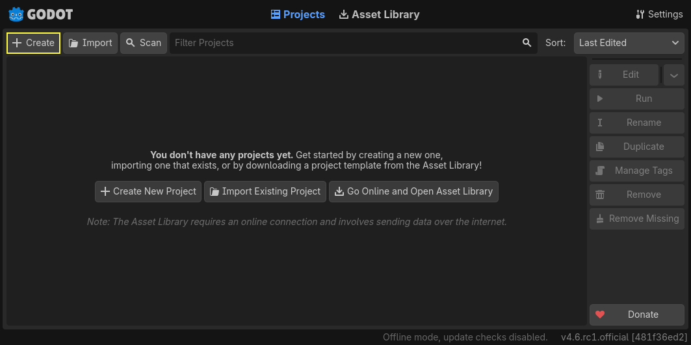

2. Project Name に `dodge_the_creeps`、Project Path は任意
3. 他は初期値のまま「Create」

### 1-2. 素材を入れる
1. dodge_the_creeps_2d_assets.zip をダウンロードして展開する（URLは「はじめに」）
2. 中の **`art/` と `fonts/` の2つのフォルダ**を、プロジェクトのフォルダへ移動（コピー）する

✅ エディタの FileSystem ドックに `art` と `fonts` が出る（出ないときは、エディタのウィンドウをクリックして少し待つ。それでも出ないときは、メニュー **Project > Reload Current Project**）。

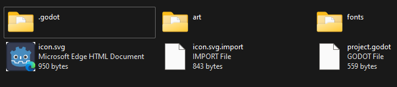


### 1-3. 画面サイズを縦長にする
このゲームは縦長の画面で遊びます。

1. メニュー **Project > Project Settings** を開く
2. 左の一覧で **Display > Window** を開く
3. **Viewport Width** を `480`、**Viewport Height** を `720` にする

    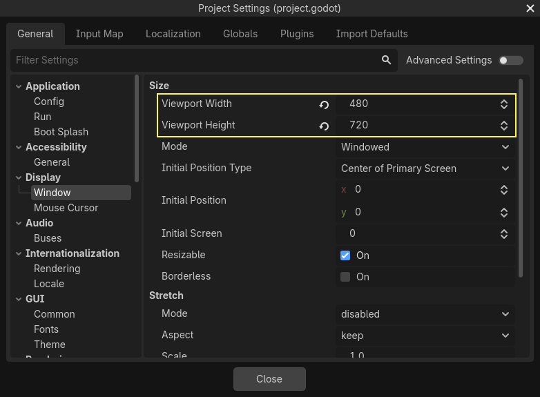

4. 同じ画面の下の方の **Stretch** で、**Mode** を `canvas_items`、**Aspect** を `keep` にする（4.7では、新規プロジェクトの Mode は最初から `canvas_items`、Aspect は `expand` になっている。Aspect だけ `keep` に変えればよい）

    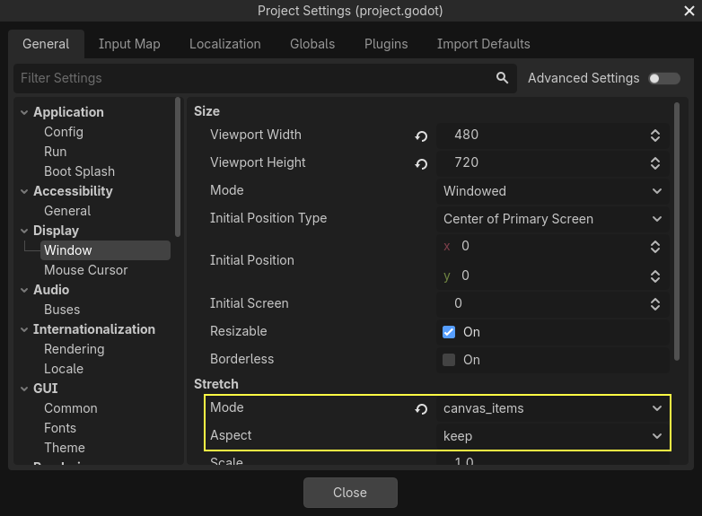

   - これで、画面サイズが違っても、同じ見た目で拡大縮小される
5. ウィンドウを閉じる

> ⚠ 設定項目が少ないときは、Project Settings 右上の **Advanced Settings** スイッチをオンにすると、すべて表示されます（※）。

### 1-4. ファイルの置き場所
小さなゲームなので、シーンもスクリプトも、プロジェクトの根（`res://`）にそのまま保存します。

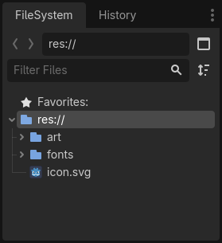


---

## パート2: プレイヤーのシーンを作る

### 2-1. 根ノードを作る
1. Scene ドックの「Other Node」→ **Area2D** を作成

    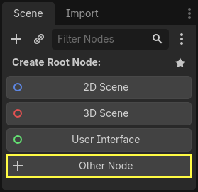

   - Area2D は「何かが重なったり、ぶつかったかを検知する」ノード
2. Area2D の横に**警告マーク（黄色い三角）**が出る。これは「当たり判定の形がまだない」という意味。**今は無視**してOK（あとで作ります）

    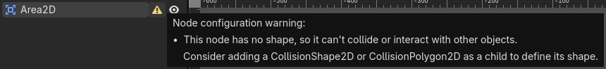

3. ノード名をダブルクリックして `Player` に変える
4. Player を選んだまま、ビューポート上部のツールバーにある**鍵アイコンの右隣のアイコン**（ツールチップ: 「選択したノードを子ごとにグループ化」）をクリック

    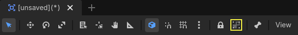

   - これで、子ノードをクリックしても、親の Player が選ばれる。子を誤って動かすのを防げる
5. **Ctrl+S**（macOS: Cmd+S）で `player.tscn` として保存

> **命名ルール**: ノード名・クラス名は PascalCase（Player）、変数・関数は snake_case（screen_size）、定数は ALL_CAPS。

### 2-2. 見た目（アニメーションする画像）
1. Player を選び、**Ctrl+A**（macOS: Cmd+A）で子ノードを追加 → **AnimatedSprite2D** を作成
2. AnimatedSprite2D にも警告が出る。これは「SpriteFrames（アニメーションのリスト）がない」という意味
3. AnimatedSprite2D を選び、Inspector の最上段にある **Sprite Frames** を `[empty]` → **New SpriteFrames**（Inspector の最上段は、Sprite Frames / Animation / Frame / Speed Scale の4項目）

    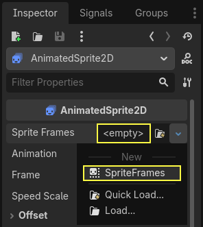

4. できた SpriteFrames をクリック → 下部に **SpriteFrames パネル**が開く

    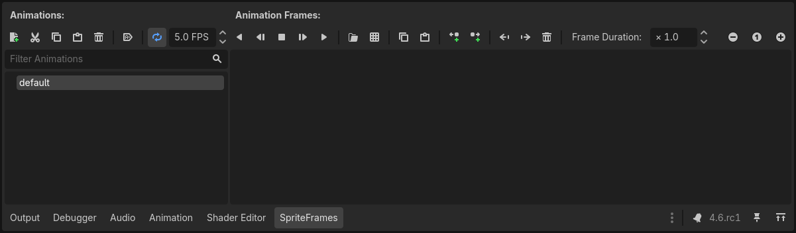

5. パネル左のアニメーション一覧にある `default` を**ダブルクリック**して、名前を **`walk`** に変える（入力したら Enter）
6. **Add Animation** ボタン（パネル左上の、いちばん左のアイコン）で、新しいアニメーションを作る。`new_animation` という名前が付くので、ダブルクリックして **`up`** に変える
   - 名前を入力するとき、**Cmd+A（全選択）は使わない**。この画面では Cmd+A が「子ノードの追加」を開いてしまう
7. FileSystem で `art` フォルダを開き、画像を**ドラッグ＆ドロップ**で、右側の **Animation Frames** 欄に入れる

    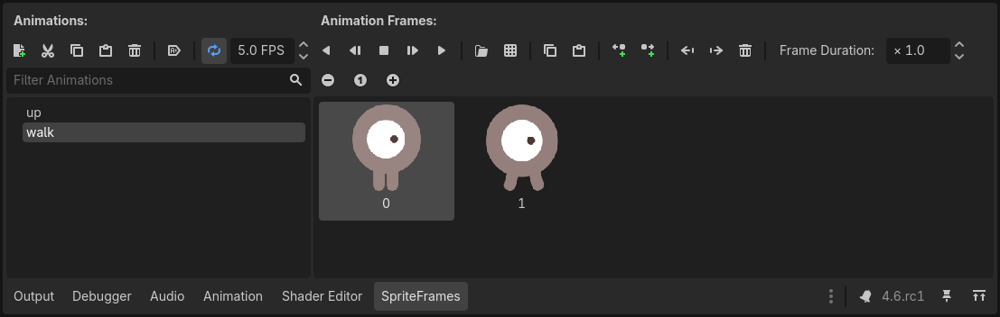


| アニメーション | 画像（2枚ずつ） |
|---|---|
| walk | playerGrey_walk1 と playerGrey_walk2 |
| up | playerGrey_up1 と playerGrey_up2 |

> ⚠ 左の一覧で、どのアニメーションを選んでいるかを確認してから、画像を入れてください（walk の欄に up の画像を入れてしまうミスが多い）。

8. 画像が大きいので、AnimatedSprite2D を選び、Inspector の **Node2D > Transform**（初期状態では折りたたまれているので、クリックで開く）の **Scale** を `(0.5, 0.5)` にする。Scale は X と Y が鎖アイコンで連動しているので、片方に入力すれば両方変わる

    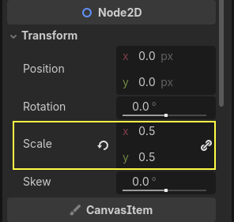


### 2-3. 当たり判定
1. Player を選び、子ノード **CollisionShape2D** を追加
2. Inspector の **Shape** を `[empty]` → **New CapsuleShape2D**
3. ビューポートのオレンジの点をドラッグして、カプセルがキャラクターを覆うように調整

    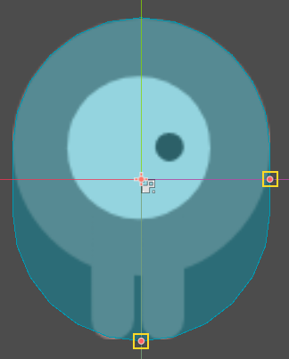


✅ Player の警告マークが消える。Scene ドックはこうなる:

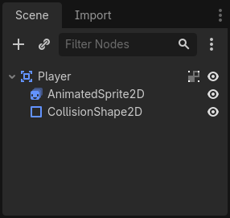


```
Player (Area2D)
├─ AnimatedSprite2D
└─ CollisionShape2D
```

4. もう一度、保存（Ctrl+S）

---

## パート3: プレイヤーのコード

### 3-1. スクリプトをつける
1. Player を選び、Scene ドック上部の **Attach Script** ボタン（巻物に＋のアイコン）をクリック

    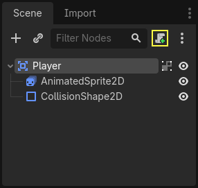

2. 設定はそのままで **Create**

    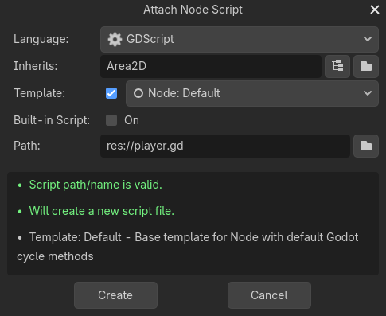


`player.gd` が開きます。最初は、テンプレートで `_ready()` と `_process()` が入っています。先頭を次のように書き換えます。

```gdscript
extends Area2D

@export var speed = 400 # プレイヤーの速さ（ピクセル／秒）
var screen_size # 画面のサイズ
```

- `@export` を付けた変数は、**Inspector で値を変えられる**ようになる（Player を選ぶと、スクリプト名のセクションに `Speed` が出る）

    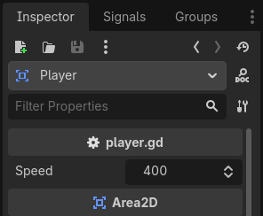


### 3-2. 準備（_ready）
`_ready()` を次のようにします。

```gdscript
func _ready():
    screen_size = get_viewport_rect().size
```

`get_viewport_rect().size` は、ゲーム画面の大きさ（480×720）です。

### 3-3. 入力アクションを作る（Input Map）
キーに名前（アクション）を付けます。

1. メニュー **Project > Project Settings** > 上部の **Input Map** タブ
2. 上の入力欄に `move_right` と入力して **Add** を押す

    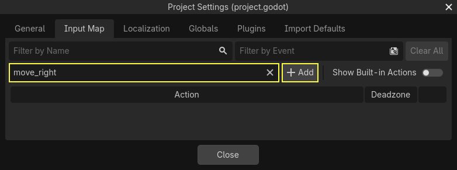

3. 追加された行の右側にある **「+」** をクリック

    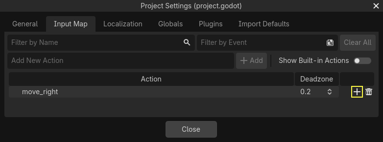

4. 「Listening for Input...」と出るので、キーボードの **→（右矢印）** を押す

    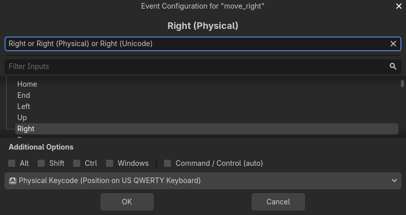

5. **OK** を押す
6. 同じようにして、あと3つ追加する:
   - `move_left` ← ←（左矢印）
   - `move_up` ← ↑（上矢印）
   - `move_down` ← ↓（下矢印）
7. **Close** で閉じる

    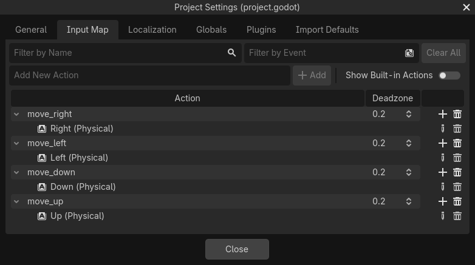


> 1つのアクションに、複数のキーやゲームパッドのボタンを割り当てることもできます。

### 3-4. 移動（_process）
`_process` を次のように書き換えます。

```gdscript
func _process(delta):
    var velocity = Vector2.ZERO # 移動の向きと大きさ
    if Input.is_action_pressed("move_right"):
        velocity.x += 1
    if Input.is_action_pressed("move_left"):
        velocity.x -= 1
    if Input.is_action_pressed("move_down"):
        velocity.y += 1
    if Input.is_action_pressed("move_up"):
        velocity.y -= 1

    if velocity.length() > 0:
        velocity = velocity.normalized() * speed
        $AnimatedSprite2D.play()
    else:
        $AnimatedSprite2D.stop()

    position += velocity * delta
    position = position.clamp(Vector2.ZERO, screen_size)
```

ポイント:
- 2D画面では、**Y軸は下向きがプラス**
- `normalized()` で、ベクトルの長さを1にそろえる。これがないと、斜め移動のときだけ速くなる
- `$AnimatedSprite2D` は `get_node("AnimatedSprite2D")` の省略形。子ノードの名前と、**大文字小文字を含め完全に一致**させる
- `clamp(...)` で、位置が画面の外に出ないように制限する
- 最後の2行は、`if / else` の**外**（字下げなし＝関数の字下げ1段）に書く

実行します。ここだけ確認用に、Player を単独で実行します。**F6**（macOS: Cmd+R）

✅ 矢印キーで、キャラクターが動く。

> ⚠ Debugger に `Attempt to call function 'play' in base 'null instance'` というエラーが出たら、`$AnimatedSprite2D` の名前が、実際のノード名と違います（スペルミスや大文字小文字）。

### 3-5. アニメーションを切り替える
`_process` の最後（`position = ...clamp...` の次）に追加します。

```gdscript
    if velocity.x != 0:
        $AnimatedSprite2D.animation = "walk"
        $AnimatedSprite2D.flip_v = false
        $AnimatedSprite2D.flip_h = velocity.x < 0
    elif velocity.y != 0:
        $AnimatedSprite2D.animation = "up"
        $AnimatedSprite2D.flip_v = velocity.y > 0
```

- 横に動くときは `walk`（左向きは左右反転 `flip_h`）
- 縦に動くときは `up`（下向きは上下反転 `flip_v`）
- `flip_h = velocity.x < 0` は、「左に動いていれば true」を代入する書き方

実行して、4方向でアニメーションが正しいか確認します。

> ⚠ アニメーション名（"walk"、"up"）は SpriteFrames パネルでの名前と**完全一致**が必要です。

最後に、ゲーム開始時はプレイヤーを隠すため、`_ready()` に追加します。

```gdscript
    hide()
```

### 3-6. 敵に当たったときの準備（シグナル）
まだ敵がいませんが、先に用意します。ファイルの先頭の `extends Area2D` の下に、シグナルを宣言します。

```gdscript
signal hit
```

これは、プレイヤーが**敵に当たったときに出す合図**です。

次に、Area2D が持っている `body_entered` シグナル（何かが入ってきたときに出る）を、自分につなぎます。
1. Player を選び、右の **Signals** タブを開く

    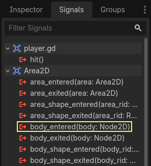

2. **body_entered(body: Node2D)** をダブルクリック
3. 設定は変えずに **Connect** をクリック

✅ スクリプトに `_on_body_entered` 関数が追加される。左端に緑の接続アイコンが付く。

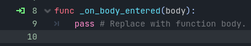


> ⚠ 緑のアイコンは「接続しようとしている」というだけで、関数が正しく存在するという意味ではありません。関数名のつづりを確認してください。外部エディタ（VS Code等）を使っていると、自動で関数が作られないことがあります。その場合は自分で書きます。

関数の中身を書きます。

```gdscript
func _on_body_entered(_body):
    hide() # 当たったら消える
    hit.emit()
    # 物理の処理中は設定を変えられないので、「あとで」変更する
    $CollisionShape2D.set_deferred("disabled", true)
```

- `hit.emit()` で、合図を出す
- 当たり判定をオフにして、2回以上当たらないようにする
- `set_deferred` は「安全なタイミングまで待ってから設定する」という意味

最後に、新しいゲームを始めるときに、プレイヤーを初期状態に戻す関数を書きます。

```gdscript
func start(pos):
    position = pos
    show()
    $CollisionShape2D.disabled = false
```

---

## パート4: 敵のシーン（Mob）

敵は、画面の端のどこかにランダムに現れて、ランダムな向きに、まっすぐ進みます。

### 4-1. ノードを作る
1. メニュー **Scene > New Scene**
2. 次の構成で作る:

```
Mob (RigidBody2D)
├─ AnimatedSprite2D
├─ CollisionShape2D
└─ VisibleOnScreenNotifier2D
```

3. 子ノードを、Player と同じく、誤って選ばないようにする: Mob を選び、2Dビュー上部ツールバーの、**鍵アイコンの右隣**のボタン（マウスを重ねると Group Selected Node(s) と出る。または **Ctrl+G**、macOS は Cmd+G）
4. Mob を選び、Inspector の **RigidBody2D** セクションの **Gravity Scale** を `0`（落ちないようにする）
5. 同じ Mob の Inspector の **CollisionObject2D > Collision** を開き、**Mask** の **`1` のチェックを外す**（敵どうしが衝突しないようにする）

    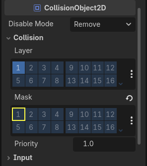


### 4-2. 見た目
1. AnimatedSprite2D に、プレイヤーと同じように SpriteFrames を作る。今回は**3つ**のアニメーション

| アニメーション | 画像（2枚ずつ、art フォルダ内）※ |
|---|---|
| fly | enemyFlyingAlt_1、enemyFlyingAlt_2 |
| swim | enemySwimming_1、enemySwimming_2 |
| walk | enemyWalking_1、enemyWalking_2 |

> ※ 画像ファイル名は art フォルダ内を見て選んでください。

2. 各アニメーションの再生速度を `3` にする（アニメーションごとに設定する）。SpriteFramesパネル左上、アニメーション一覧の上のツールバーにある **「5.0 FPS」と表示された欄**（マウスを重ねると Animation Speed と出る）の数字を `3` に変えます。上部の再生ボタンでプレビューできる

    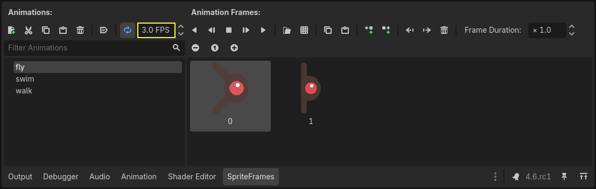

3. AnimatedSprite2D の **Node2D > Transform**（折りたたまれているので開く）の **Scale** を `(0.75, 0.75)`
4. CollisionShape2D の **Shape** に **CapsuleShape2D** を設定し、**Node2D > Transform**（折りたたまれているので開く）の **Rotation** を `90` にして、画像に合わせる
5. VisibleOnScreenNotifier2D は、画面から出たことを知らせるノード。小さいままでもOK
6. **mob.tscn** として保存

### 4-3. 敵のスクリプト
Mob にスクリプトをつけます（Attach Script → Create）。

```gdscript
extends RigidBody2D

func _ready():
    var mob_types = Array($AnimatedSprite2D.sprite_frames.get_animation_names())
    $AnimatedSprite2D.animation = mob_types.pick_random()
    $AnimatedSprite2D.play()

func _on_visible_on_screen_notifier_2d_screen_exited():
    queue_free()
```

- `_ready()` で、3つのアニメーション名（walk / swim / fly）から**ランダムに1つ**選んで再生する
- `queue_free()` は、そのノードを削除する

`_on_visible_on_screen_notifier_2d_screen_exited` は、シグナルの接続で作ります。
1. **VisibleOnScreenNotifier2D** を選び、Signals タブを開く
2. **screen_exited()** をダブルクリック → 接続先は **Mob** → **Connect**
3. 関数の中に `queue_free()` を書く（上のコード）

保存します。

---

## パート5: メインのシーン

### 5-1. ノードを作る
1. Scene > **New Scene** で、**Node**（Node2D ではなく Node）を作り、名前を `Main` にする
   - Main は、ゲームの流れを管理するだけで、2Dの位置は要らないため
2. Scene ドックの **Instantiate Child Scene**（鎖アイコン）を押して、`player.tscn` をインスタンス化

    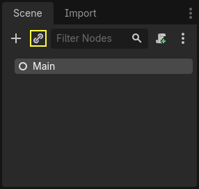

3. Main を選び、次の子ノードを追加して、名前を付ける:

| ノード | 名前 | 役割 |
|---|---|---|
| Timer | MobTimer | 敵を出す間隔 |
| Timer | ScoreTimer | スコアを毎秒加算 |
| Timer | StartTimer | 開始までの待ち時間 |
| Marker2D | StartPosition | プレイヤーの開始位置 |

4. 各ノードの値を設定する

| ノード | 設定 |
|---|---|
| MobTimer | Wait Time = `0.5` |
| ScoreTimer | Wait Time = `1` |
| StartTimer | Wait Time = `2`、**One Shot** = オン |
| StartPosition | Position = `(240, 450)` |

### 5-2. 敵の出現位置（Path2D）
1. Main に **Path2D** を追加して、名前を `MobPath` にする
2. Path2D を選ぶと、ビューポート上部に新しいボタンが出る。真ん中の **Add Point** を選ぶ

    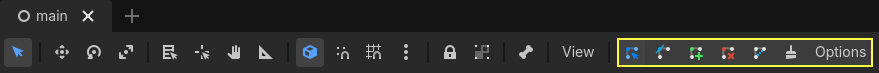

3. スナップを使うために、ツールバーの磁石アイコン（**Use Grid Snap** と **Use Smart Snap**）を、2つともオンにする

    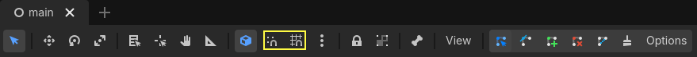

4. 画面の**4つの角**を、**時計回り**に順にクリックして点を作る。左上 → 右上 → 右下 → 左下
   - ⚠ 反時計回りだと、敵が**外向き**に出てしまいます
5. 4つ目の点を作ったら、**Close Curve** ボタンを押して、閉じる

    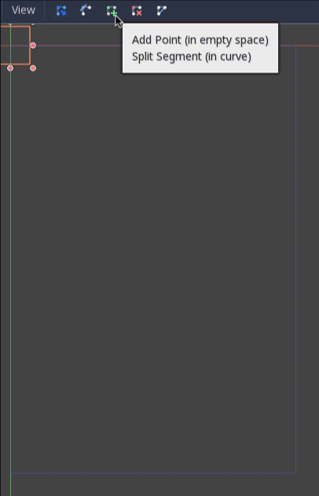

6. MobPath の子に **PathFollow2D** を追加して、名前を `MobSpawnLocation` にする

    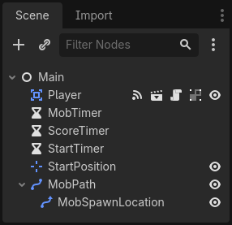

   - パス上の位置を選ぶと、そこでの向きに自動で回転してくれる

### 5-3. Main のスクリプト
Main にスクリプトをつけて（Attach Script → Create）、先頭を次のようにします。

```gdscript
extends Node

@export var mob_scene: PackedScene
var score
```

Main を選ぶと、Inspector に **Mob Scene** が出ます。**FileSystem の `mob.tscn` をそこへドラッグ＆ドロップ**します（これを忘れると、敵が出ません）。

### 5-4. シグナルをつなぐ
**(a) プレイヤーの hit を Main へ**
1. Scene ドックで、Player を選ぶ
2. Signals タブで **hit** をダブルクリック
3. 接続先は **Main**。**Receiver Method** に `game_over` と入力して **Connect**

**(b) 3つのタイマーの timeout を Main へ**
- StartTimer、ScoreTimer、MobTimer を、それぞれ選び、Signals タブで **timeout()** をダブルクリック → 初期設定のまま **Connect**

✅ スクリプトに、次の関数名が追加されている:
`game_over`、`_on_start_timer_timeout`、`_on_score_timer_timeout`、`_on_mob_timer_timeout`

### 5-5. 関数の中身を書く
```gdscript
func game_over():
    $ScoreTimer.stop()
    $MobTimer.stop()

func new_game():
    score = 0
    $Player.start($StartPosition.position)
    $StartTimer.start()

func _on_score_timer_timeout():
    score += 1

func _on_start_timer_timeout():
    $MobTimer.start()
    $ScoreTimer.start()
```

`_on_mob_timer_timeout` は、敵を出す処理です。

```gdscript
func _on_mob_timer_timeout():
    # 敵（Mob）の新しいインスタンスを作る
    var mob = mob_scene.instantiate()

    # パス上のランダムな位置を選ぶ
    var mob_spawn_location = $MobPath/MobSpawnLocation
    mob_spawn_location.progress_ratio = randf()

    # 敵をその位置に置く
    mob.position = mob_spawn_location.position

    # 進む向きは、パスに垂直（内向き）。少しランダムにずらす
    var direction = mob_spawn_location.rotation + PI / 2
    direction += randf_range(-PI / 4, PI / 4)
    mob.rotation = direction

    # 速さをランダムに選んで、進ませる
    var velocity = Vector2(randf_range(150.0, 250.0), 0.0)
    mob.linear_velocity = velocity.rotated(direction)

    # ゲームに加える（これを忘れると表示されない）
    add_child(mob)
```

- `randf()` は 0〜1 の乱数。`progress_ratio` は 0=パスの始め、1=終わり
- `add_child(mob)` を呼ばないと、敵はシーンに追加されない

### 5-6. テスト
1. 一時的に `_ready()` を作って、`new_game()` を呼ぶ

```gdscript
func _ready():
    new_game()
```

2. **F5**（macOS: Cmd+B）→ メインシーンを選ぶダイアログが出たら `main.tscn` を選ぶ
   - すでに別のシーンをメインシーンにしている場合は、FileSystem で main.tscn を右クリック > **Set As Main Scene**

✅ プレイヤーが動かせて、敵が出てきて、当たると消える。

3. 確認できたら、`_ready()` の `new_game()` を `pass` に書き換える

```gdscript
func _ready():
    pass
```

---

## パート6: HUD（スコアやボタンの画面）

### 6-1. ノードを作る
1. Scene > **New Scene** > **Other Node** → **CanvasLayer** を作り、名前を `HUD`
   - CanvasLayer は「ゲーム画面の手前の層」。敵やプレイヤーに隠されない
2. 子ノードを追加する:

| ノード | 名前 |
|---|---|
| Label | ScoreLabel |
| Label | Message |
| Button | StartButton |
| Timer | MessageTimer |

### 6-2. フォントと大きさ
Inspector の項目は、初期状態では多くが**折りたたまれています**（▸ をクリックで開く）。Label の Inspector は縦に長いので、下へスクロールして探します。

1. ScoreLabel を選び、Inspector 最上部の **Text** 欄に `0` と入力
2. Inspector を下へスクロールし、**Theme Overrides**（折りたたまれている）を開く。中に Colors / Constants / **Fonts** / **Font Sizes** / Styles が並び、これもそれぞれ折りたたまれている
3. **Fonts** を開くと **Font** という行が出る。右の `<empty>` 欄の ▾ → **Load**（または Quick Load）→ `fonts/Xolonium-Regular.ttf` を選ぶ（左のチェックボックスは自動でオンになる）

    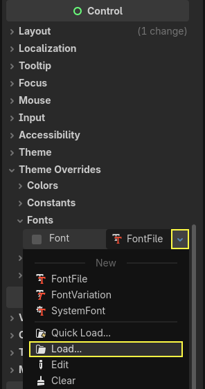

4. **Font Sizes** を開くと **Font Size**（初期値 16）が出る。`64` にする

    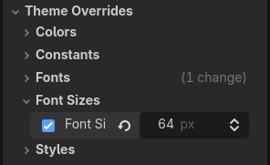

5. **Message** と **StartButton** にも、同じ設定（フォントとサイズ）をする

### 6-3. 配置
Label や Button のような UI 部品（Control）の位置・大きさは、Inspector の **Layout** セクション（折りたたまれている）にあります。

- **Anchors Preset** は **Layout** を開くと出る、`Top Left` と表示されたドロップダウン（2Dビュー上部ツールバーにも、Control を選ぶと同じメニューが出る）
- **Size X / Size Y / Position** は、Layout の中の **Transform**（さらに折りたたまれている）を開くと出る
- ※ HUD は CanvasLayer の子なので、Layout に「This node doesn't have a control parent」と青い案内が出ますが、そのまま進めてOKです

**ScoreLabel**
1. Text = `0`
2. **Horizontal Alignment** と **Vertical Alignment**（Inspector 上の方、項目名は途中で切れて `Horizontal Align` のように見える）を `Center`
3. Layout > **Anchors Preset** を **Center Top**

    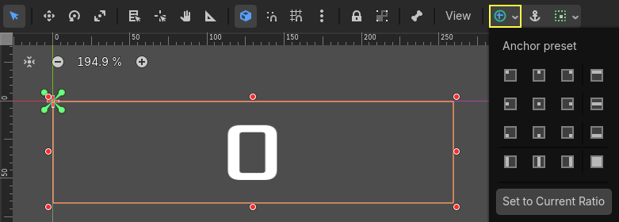


**Message**
1. Text = `Dodge the Creeps!`
2. Horizontal / Vertical Alignment を `Center`
3. **Autowrap Mode** を `Word`（これがないと1行になる）
4. Layout > Transform の **Size X** を `480`
5. Anchors Preset を **Center**

**StartButton**
1. Text = `Start`
2. Layout > Transform の **Size X** = `200`、**Size Y** = `100`
3. Anchors Preset を **Center Bottom**
4. **Position Y** = `580`

**MessageTimer**: Wait Time = `2`、**One Shot** = オン

> **アンカー（Anchor）とは**: UI部品（Control）が、画面や親のどの位置を基準にするかの設定。「Anchor Preset」から選ぶと、位置合わせが簡単です。

### 6-4. HUD のスクリプト
HUD にスクリプトをつけて、次を書きます。

```gdscript
extends CanvasLayer

# ボタンが押されたことを Main に知らせる
signal start_game

func show_message(text):
    $Message.text = text
    $Message.show()
    $MessageTimer.start()

func show_game_over():
    show_message("Game Over")
    # MessageTimer が終わるまで待つ
    await $MessageTimer.timeout

    $Message.text = "Dodge the Creeps!"
    $Message.show()
    # 1秒待ってから Start ボタンを出す
    await get_tree().create_timer(1.0).timeout
    $StartButton.show()

func update_score(score):
    $ScoreLabel.text = str(score)
```

- `await` は、「そのシグナルが出るまで、ここで待つ」という意味

次に、シグナルをつなぎます（接続先はどちらも HUD）。
- **StartButton** の `pressed()`
- **MessageTimer** の `timeout()`

```gdscript
func _on_start_button_pressed():
    $StartButton.hide()
    start_game.emit()

func _on_message_timer_timeout():
    $Message.hide()
```

保存して、`hud.tscn` と名前を付けます。

### 6-5. HUD を Main につなぐ
1. Main シーンを開く
2. **Instantiate Child Scene** で `hud.tscn` を追加
3. HUD を選び、Signals タブで **start_game** をダブルクリック → 接続先 Main、Receiver Method に `new_game` を指定（**Pick** ボタンで選んでもよい）→ Connect

Main のスクリプトを、次のように変更します。

`new_game()` の最後に追加:
```gdscript
    $HUD.update_score(score)
    $HUD.show_message("Get Ready")
```

`game_over()` の最後に追加:
```gdscript
    $HUD.show_game_over()
```

`_on_score_timer_timeout()` の最後に追加:
```gdscript
    $HUD.update_score(score)
```

✅ F5 で実行 → 「Start」ボタンで始まり、当たると「Game Over」が出て、またスタートできる。

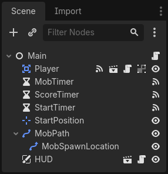


### 6-6. 前のゲームの敵を消す
Start を押したとき、前回の敵が残っていると不便です。**グループ**を使って、全員を一気に消します。

1. mob.tscn を開き、根の **Mob** を選ぶ
2. Inspector の隣の **Groups** タブを開き、**+** をクリック

    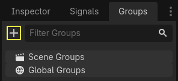

3. 名前を `mobs` として **OK**

    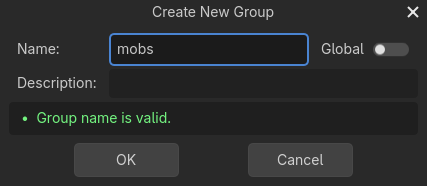

4. Main の `new_game()` に、次を追加:

```gdscript
    get_tree().call_group("mobs", "queue_free")
```

`call_group` は、グループのすべてのノードで、指定した関数を呼びます。

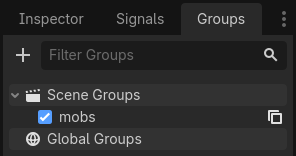


---

## パート7: 仕上げ

### 7-1. 背景
1. Main に **ColorRect** を追加し、**ツリーの一番上**（先頭の子）に移動する（上にあるほど奥に描かれる）
2. Inspector で好きな **Color** を選ぶ
3. **Layout > Anchors Preset > Full Rect** を選ぶ（画面全体に広がる）

### 7-2. 音
1. Main に **AudioStreamPlayer** を2つ追加し、名前を `Music` と `DeathSound` にする
2. それぞれの **Stream** プロパティで **Load** → 音声ファイルを選ぶ

| ノード | ファイル（art フォルダ） |
|---|---|
| Music | House In a Forest Loop.ogg |
| DeathSound | gameover.wav |

3. 音楽をループさせたい場合: Music の Stream の右の矢印 > **Make Unique** → Stream をクリック → **Loop** にチェック

    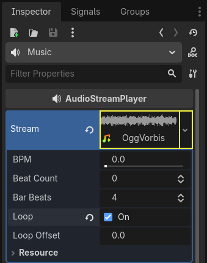

4. Main のスクリプトに追加:
   - `new_game()` の最後: `$Music.play()`
   - `game_over()` の最後: `$Music.stop()` と `$DeathSound.play()`

### 7-3. Enter キーで開始
1. Project > Project Settings > **Input Map** で、アクション `start_game` を追加し、**Enter** キーを割り当てる

    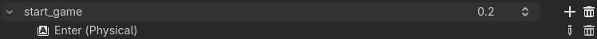

2. HUD シーンを開き、**StartButton** の Inspector で **Shortcut** をクリックして、新しい **Shortcut** リソースを作る

    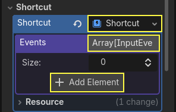

3. **Events** の配列を開き、**Array[InputEvent] (size 0)** をクリックして要素を追加
4. 新しい **InputEventAction** を作り、**Action** を `start_game` にする

    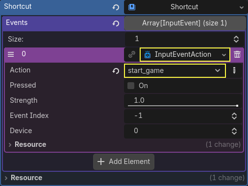


✅ Start ボタンが出ているときに、Enter キーでも始められる。

### 7-4. ゲームパッド対応（任意）
Input Map で、各アクションの「+」を押して、ゲームパッドのボタンや十字キーを割り当てます。

### 完成おめでとうございます
プレイヤー操作、敵の出現、スコア、ゲームオーバー、リトライ、UI、音が揃いました。

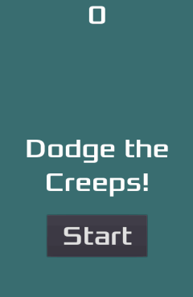


### 友達に遊んでもらうには
Project > Export で、各OS向けに書き出します。書き出した実行ファイルと PCK ファイルを ZIP にして渡します（プロジェクトのフォルダそのものではなく）。

---

## 付録: 完成コード（答え合わせ用）

### player.gd
```gdscript
extends Area2D

signal hit

@export var speed = 400
var screen_size

func _ready():
    screen_size = get_viewport_rect().size
    hide()

func _process(delta):
    var velocity = Vector2.ZERO
    if Input.is_action_pressed("move_right"):
        velocity.x += 1
    if Input.is_action_pressed("move_left"):
        velocity.x -= 1
    if Input.is_action_pressed("move_down"):
        velocity.y += 1
    if Input.is_action_pressed("move_up"):
        velocity.y -= 1

    if velocity.length() > 0:
        velocity = velocity.normalized() * speed
        $AnimatedSprite2D.play()
    else:
        $AnimatedSprite2D.stop()

    position += velocity * delta
    position = position.clamp(Vector2.ZERO, screen_size)

    if velocity.x != 0:
        $AnimatedSprite2D.animation = "walk"
        $AnimatedSprite2D.flip_v = false
        $AnimatedSprite2D.flip_h = velocity.x < 0
    elif velocity.y != 0:
        $AnimatedSprite2D.animation = "up"
        $AnimatedSprite2D.flip_v = velocity.y > 0

func _on_body_entered(_body):
    hide()
    hit.emit()
    $CollisionShape2D.set_deferred("disabled", true)

func start(pos):
    position = pos
    show()
    $CollisionShape2D.disabled = false
```

### mob.gd
```gdscript
extends RigidBody2D

func _ready():
    var mob_types = Array($AnimatedSprite2D.sprite_frames.get_animation_names())
    $AnimatedSprite2D.animation = mob_types.pick_random()
    $AnimatedSprite2D.play()

func _on_visible_on_screen_notifier_2d_screen_exited():
    queue_free()
```

### main.gd
```gdscript
extends Node

@export var mob_scene: PackedScene
var score

func _ready():
    pass

func game_over():
    $ScoreTimer.stop()
    $MobTimer.stop()
    $HUD.show_game_over()
    $Music.stop()
    $DeathSound.play()

func new_game():
    score = 0
    $Player.start($StartPosition.position)
    $StartTimer.start()
    $HUD.update_score(score)
    $HUD.show_message("Get Ready")
    get_tree().call_group("mobs", "queue_free")
    $Music.play()

func _on_score_timer_timeout():
    score += 1
    $HUD.update_score(score)

func _on_start_timer_timeout():
    $MobTimer.start()
    $ScoreTimer.start()

func _on_mob_timer_timeout():
    var mob = mob_scene.instantiate()

    var mob_spawn_location = $MobPath/MobSpawnLocation
    mob_spawn_location.progress_ratio = randf()

    mob.position = mob_spawn_location.position

    var direction = mob_spawn_location.rotation + PI / 2
    direction += randf_range(-PI / 4, PI / 4)
    mob.rotation = direction

    var velocity = Vector2(randf_range(150.0, 250.0), 0.0)
    mob.linear_velocity = velocity.rotated(direction)

    add_child(mob)
```

### hud.gd
```gdscript
extends CanvasLayer

signal start_game

func show_message(text):
    $Message.text = text
    $Message.show()
    $MessageTimer.start()

func show_game_over():
    show_message("Game Over")
    await $MessageTimer.timeout
    $Message.text = "Dodge the Creeps!"
    $Message.show()
    await get_tree().create_timer(1.0).timeout
    $StartButton.show()

func update_score(score):
    $ScoreLabel.text = str(score)

func _on_start_button_pressed():
    $StartButton.hide()
    start_game.emit()

func _on_message_timer_timeout():
    $Message.hide()
```

次は第4章へ。
